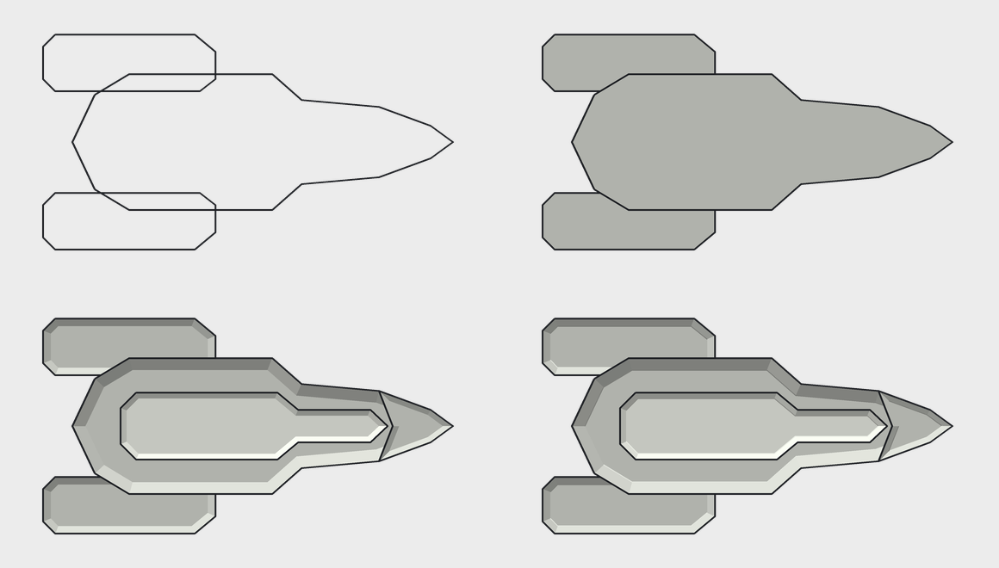
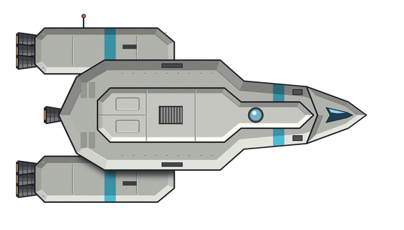
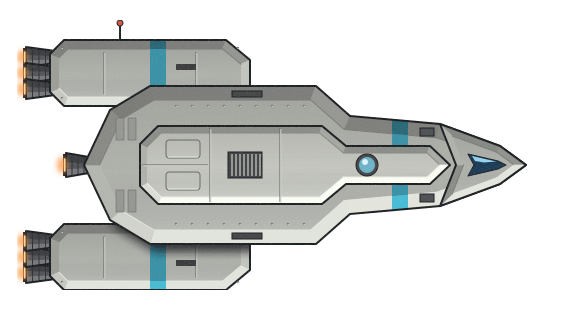

# Art Test 01: Raster PNG vs. SVG

**Date:** 2026-10-19
**Decision:** SVG is the art format for Infall.

## Goal

Find out whether vector art (SVG) can match FTL-style raster art, and which format suits Infall better.

## What was done

The test subject is an original FTL-style scout ship, not traced from any FTL asset.

### Step 1: Raster (PNG)

Drawn with Python + Pillow in the stages outline → fill → shade → highlight → details,
then reviewed and edited three times.

| Pass | Changes |
|---|---|
| v1 | First full draw. Bevels too thin, hull face empty, stripe broken across the spine, engines looked bolted on. |
| v2 | Wider chamfered bevels lit by edge direction, stripe shaded across the bevels, ribbed engine bells, separate nose and deck plates. |
| v3 | Nose blended into the hull, fixed a nacelle seam drawn over the hull, added the hull's shadow on the nacelles and a central thruster. |
| v4 | Toned down blown-out highlight lips, stronger nacelle shadow, service panels on the aft hull. **Final.** |

Final PNG:

### Step 2: Vector (SVG)

The same ship rebuilt as an SVG and rendered in Chromium for review, then edited three times.

| Pass | Changes |
|---|---|
| v1 | Direct rebuild. Matched the PNG, but the noise filter was too gritty and dulled the accent colour. |
| v2 | Grain reduced, hairline gaps between facets hidden, subtle gradient sheen on each face. |
| v3 | Highlight lines no longer cut across the accent stripe; soft blurred engine glows. **Final.** |

Final SVG:

`final-svg-render-2x.png` is the same SVG rendered at 2× zoom, showing it stays sharp.

## Findings

- At normal size the two are nearly identical.
- The SVG stays sharp at any zoom; the PNG softens when scaled up.
- The SVG is 29 KB of readable text, with every part a named group (`hull`, `nacelle-port`, `cockpit`, `engine-glow`, …),
  so the game could recolour, hide or animate individual parts.
- Soft effects (glow, shadow, grain) were simple SVG filters but needed custom code in the raster version.
- SVG needs care where shapes meet to avoid hairline seams.
- Generating the SVG from a script was much faster than placing shapes by hand would be.

## Decision

SVG is superior for Infall and is adopted as the art format.

## Files

| File | What it is |
|---|---|
| `final.png` | Final raster version (PNG v4) |
| `final.svg` | Final vector version (SVG v3) |
| `final-svg-render-2x.png` | `final.svg` rendered at 2× |
| `png-stages.png` | Outline, fill, shade and highlight stages of the PNG |
| `tools/ship_png.py` | Draws the PNG: `python3 ship_png.py [stage 1-5] [out.png]` |
| `tools/ship_svg.py` | Builds the SVG from the same geometry: `python3 ship_svg.py [out.svg]` |
| `tools/render.js` | Renders an SVG to PNG with Playwright/Chromium: `node render.js in.svg out.png [scale]` |
