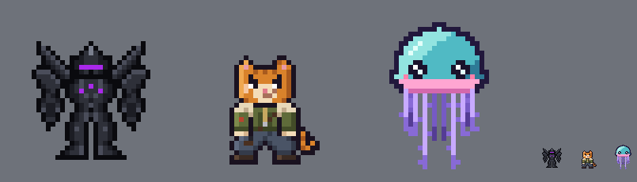

# Mercenary cat crew (new race, working name)

**Date:** 2026-10-28
**Status:** first sprite for heromedel's new race. The race's name, lore and systems aren't decided yet: "cat-merc" is
only a folder name.

heromedel's brief (2026-10-28): a race about human height, shorter than the Mecha crew; a mercenary cat in loose pants
and a cool jacket, cute but tough; in the game's general style (the Mecha and Tentauri crew sheets).

The sprite (`svg/cat-merc.svg`, built by `tools/cat.py`; **Ai-Generated-Proposal** in every detail): pixel art on the
crew grid, a 35 × 35 frame like the other crews, facing down, 23 pixels tall (the Mecha crew is 25). A one-pixel dark
outline and flat two- to three-tone shading lit from the upper left, as the other two sheets have.

- **Cute:** a big head with big ears (pink inside), a cream muzzle, a pink nose, cheek fluff, a striped tail with a curl.
- **Tough:** stern brows, high at the outside and low toward the nose, with a smirk (heromedel: the first squint
  looked too sad; its brows rose toward the nose; `review/cat-merc-faces.png` compares four faces, and a blind
  check picked this one as "smug, cocky and self-assured"), a notched ear, a scar down the cheek, a strap across the
  chest, a pistol holstered on the hip.
- **Clothes:** an olive bomber jacket with a shearling collar and cuffs, a red unit patch on the sleeve and a ribbed
  hem; loose grey-blue pants gathered over brown leather boots.

Blind checks, six rounds: from "a cat in a jacket", 6/10 (the tough side missing), to "wary and stern... cute but tough,
mostly", 7/10, with the squint, the strap and the holster. Still flagged: no visible weapon beyond the holster, the
tail's base a little detached at the hip.
