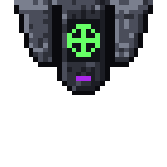

# Mecha console

**Date:** 2026-10-25
**Status:** picked by heromedel (the tower with stepped cheeks; arm ports removed 2026-10-25). Not yet used in a
floor plan: the Mecha Light
Attack Frame's plans will take it when the frame is redone in the Mecha pixel style.

A Mecha system console for one 35 × 35 tile, drawn in the Mecha style (`docs/art/README.md`, race rendering styles):
pixel art on the grid, near-black armour from the Mecha palette with a gritty, uneven texture, and purple hinted in a
pixel or two (a slit at the base). A narrow armoured tower with the screen and the system's symbol
(in power green on the screen), between two heavy stepped cheeks.

- **No arm ports (2026-10-25):** the tower first had two sockets where the HalfMech's hands land when it types on
  the north wall. On every other wall the hands missed them, and fixing that meant redrawing the sprite and the
  console for each wall, so heromedel had them removed. Now the console is simply turned to face its wall, and the
  HalfMech stands and types on the console's own tile (art rules: no system blocks a tile). Tested in a 2×2 room
  with the power-pulse typing frames, at full depth (20 px, picked) and at a shorter 15 px.
- **How it was picked:** three console shapes (slab, tower, low bar), each with and without ports, shown with the
  typing frame over them (`console-options.png`); heromedel picked the tower with ports, made more pixelated and
  menacing. Three cheek shapes in pixel art (`tower-options.png`): blade, stepped (picked) and claw.

## Tools

| File | What it does |
|---|---|
| `tools/consoles.py` | The first console shapes, with and without ports: `python3 consoles.py ../../crew/mecha-crew-sheet.svg OUT.svg` |
| `tools/tower_px.py` | The picked console: `python3 tower_px.py --picked ../mecha-console-tower.svg`. The option sheet (three cheek shapes, with ports, the typing frame over each): `python3 tower_px.py ../../crew/mecha-crew-sheet.svg OUT.svg` (writes `tower-*.svg` beside it) |
