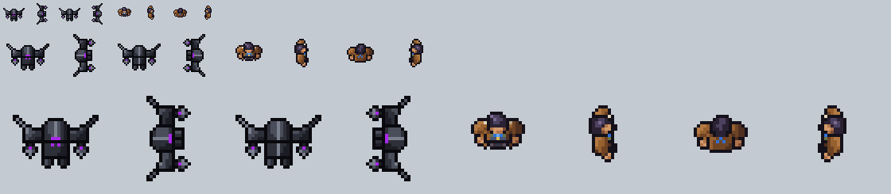

# Mecha crew, top-down test

**Date:** 2026-11-11
**Status:** a test, third version, shown to heromedel and not yet judged. It answers one question: can the nearly
top-down view that worked for the Terran drifter (`docs/art/terran/crew-test-4`) be drawn for a race that has no
human sheet to follow?

A HalfMech in its suit, standing and walking in the four directions, at the drifter's frame size (35 by 35).

- `mecha-topdown-walk-sheet.png` (and `-4x`): row 1 walk down then walk right, row 2 walk up then walk left, four
  frames each.
- `review/walks-8x.gif` and `-4x.gif`: the four walks moving. `review/views-10x.png`: the four standing views.
  `review/beside-the-drifter.png`: both figures at game size, twice and four times.
  `review/beside-heromedels-drawing.png`: the front view beside the drawing it follows.
- `reference/heromedel-mecha-topdown.png` (and `-8x`): heromedel's own drawing of the suit from above, standing and
  facing the camera, 86 by 48 pixels, about four times game size. It was offered as one more inspiration, not as
  law.

## The design

After heromedel's drawing, brought down to game size by hand (nothing is scaled or traced), in the colours of the
Mecha crew palette (`docs/art/palette.md`):

- A boxy helm with a pale ridge down the middle and a short purple visor bar on its front edge. The ridge reaches
  one pixel past the top of the helm, a slight point, with the outline pixel there pushed up one (heromedel,
  2026-11-11). Side on, the same point shows at the back of the helm.
- A shoulder plate each side, with a thick spike sweeping up and out of its outer corner. They are shoulders:
  HalfMech suits do not have wings (heromedel, 2026-11-11).
- An arm straight down from under each plate to a grey powered clamp claw with a purple band. heromedel likes the
  clamp claws, and asked for them straight, not bent, and for the thicker spikes of the first version (2026-11-11).
- Two chest lights under the visor, on a torso four rows deep, and two pointed feet. The torso was two rows;
  heromedel had it extended down two pixels with the lights left where they were (2026-11-11). The back view has
  the same torso. Its two bottom outline corners are trimmed, as on the drifter's coat (heromedel, 2026-11-11).
- **A hint of a face (heromedel, 2026-11-11):** on the front the two chest lights are eyes, and a mouth three pixels
  wide sits under them, one tone darker than the armour. It is meant to be hard to notice.
- **Helm shading:** the tones fall off from the top left to the bottom right. They were in columns either side of
  the ridge, the same fault the feet had. `review/helm-shading-before-after-16x.png` shows front and back, before
  then after.
- The feet are two pixels long and stand apart from the torso and from each other, each with its own outline
  (heromedel, 2026-11-11). A stepping foot reaches a pixel further and the other draws in a pixel. Each
  foot is shaded from the top left (one lit pixel, armour, shadow at the bottom right), not in columns, which read
  as vertical stripes.
- **Spikes and arms at different angles (heromedel, 2026-11-11):** the spike leans out from the plate's outer
  corner and the claw hangs straight from under its middle. The first version of this test hung each claw straight
  under a blade that stood straight above it, and on a still frame the two read as one stacked piece.

How the other views follow from it:

- From behind there is no visor and no chest light. The crest still runs the whole helm, but the back plate is plain
  dark shading with no pale line down it (heromedel, 2026-11-11). The claws keep their bands.
- Facing right is the front view turned a quarter: one shoulder plate above the helm and one below, the spikes
  sweeping back and out, the claws pointing straight ahead, the visor on the helm's front edge.
- Standing side on, both feet show ahead of the helm, so he is not so thin (heromedel, 2026-11-11).
- Side on is not a strict quarter turn (heromedel, 2026-11-11): his left shoulder, the far one at the top when he
  faces right, is a row shorter where it meets the helm, and his feet sit toward the near side, the left foot a
  row down and the right foot two. The ridge, the visor and the crest's point sit one row above the helm's
  middle, toward the far side; the helm's own shape is unchanged.
- **The walk swings (heromedel, 2026-11-11).** The first walks lengthened and shortened the arms and legs, which
  read as pistons. Now every part keeps its shape and moves as a piece: a shoulder plate swings a row forward with
  its spike and claw, the other swings a row back and its claw tucks up under it, and the foot opposite the forward
  arm swings forward on a pixel of leg while the other draws back under the torso. The genre's rock crew, the
  nearest build to this one, walks the same way: its whole shoulder line tilts with each step.

## What I think of it

- The front and back views read as heromedel's suit at game size.
- The side view is still the weakest. It is correct as a turn of the front view, but with the shoulder plates as long as
  they are it reads as a bracket more than as a figure.

## Tools

`python3 tools/build.py`, run from this folder, rebuilds the sheet and the pictures. `tools/mech.py` holds the frames
as text, one character a pixel. The build borrows the picture helpers of `docs/art/terran/crew-test-4/tools/pix.py`.
