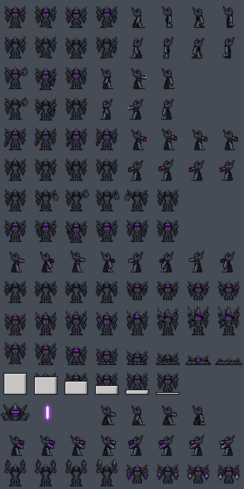

# Mecha crew sprite sheet

**Date:** 2026-10-25
**Status:** heromedel's sheet, saved as the reference for Mecha (HalfMech) crew. Source:
https://claude.ai/artifact/Rac3hEG59XfS34BkiFTWXy

A HalfMech in its mech suit as a crew sprite: low-res pixel art with a gritty, broken-up pixel texture, a Gundam mech
shape (not a rounded, friendly robot), near-black armour with one accent, Mecha power purple (`#AA28EB`, in
`docs/art/palette.md` with the rest of the palette). It follows FTL's Lanius crew sprite frame for frame (crest head,
blade forearms raised beside the head, short legs) with new armour and colours, and FTL's crew sheet layout.

280 × 560 pixels: 35 × 35 frames, 8 per row, 16 rows.

| Row | Frames |
|---|---|
| 1 | Walk down, then walk right |
| 2 | Walk up, then walk left |
| 3 | Shoot down, then shoot right |
| 4 | Shoot up, then shoot left |
| 5 | Fight fire down, then right |
| 6 | Fight fire up, then left |
| 7 | Punch up |
| 8 | Punch down |
| 9 | Type right, then type left |
| 10 | Type up, then type down |
| 11 | Teleport |
| 12 | Death (melts feet first) |
| 13 | Clone |
| 14 | Portrait, crew laser shot, repair |
| 15 | Power-pulse typing, right then left |
| 16 | Power-pulse typing, up then down |

- **Powering a system:** rows 15 and 16 replace the earlier integration ideas (docking pods, limb sockets). The
  HalfMech works an ordinary console and a pulse runs from it, starting in Mecha power purple and turning power green
  (`#66FF66`) as it reaches the console, so it works on any race's console.

## Lessons for crew art (from the attempts this sheet replaced)

- Crew are 35 × 35 pixel sprites: design at true size, pixel by pixel on the grid, not as a large vector drawing.
- Start from the reference sprite and change it; don't invent a new body.
- Menace comes from the silhouette and a dark palette with one accent, not from faces, eyes, grilles or bolts.
- Detail is hinted by a pixel or two, never drawn out, and the pixels are gritty, not clean flat shapes.
- The test: it should look made on a Nintendo, not in Flash.
