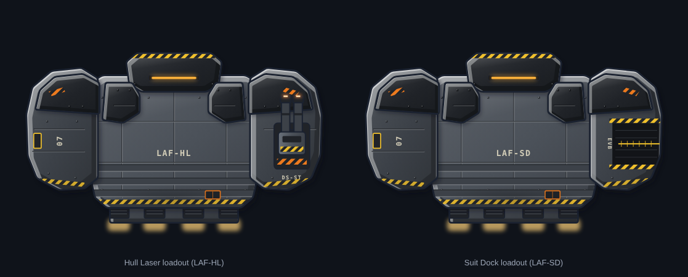

# Mecha Light Attack Frame (Hull Laser and Suit Dock loadouts)

**Date:** 2026-10-23
**Status:** accepted by Ship Designs. Ship design: `docs/ship-suggestions.md`, "Mecha Light Attack Frame, two
loadouts". Race: `docs/race-profiles.md`, The Mecha (HalfMechs).

## What it is

One standard frame with two loadouts, in gunmetal and black with yellow and orange hazard markings. Seen from above it
reads like a mech's torso: armoured shoulders over the sponsons, a helm with an amber visor slit at the bow, chest
plates, abdominal armour bands, and an engine pack with four rectangular thrust ports. Wide, squat and military, with
uniform panels and stencilled codes instead of emblems. No rocket shapes: no nose cone, fins or engine bells.

| Loadout | Stencil | Starboard shoulder | Weapon |
|---|---|---|---|
| Hull Laser | LAF-HL | an armoured pod housing with a hardpoint ring, like a shoulder cannon; hidden mount `mount-hull-laser` | DS-ST Hull Laser (`docs/art/weapons/ds-st-hull-laser/`) |
| Suit Dock | LAF-SD | an open launch bay facing outboard, hazard-framed, with a launch rail | laser battlesuit (`docs/art/weapons/battlesuit-laser/`), launched from the bay |

- **Hulls** in `mecha-laf-*-hull.svg`: top-down, nose up, 440 × 330. `mecha-laf-hull-laser-mounts.svg` shows the mount.
- **Preview:** `mecha-laf-hull-laser-armed-preview.*` places the laser at the mount at 1.4× its file size.
- **Port shoulder:** the spare room and its airlock hatch. A second airlock hatch sits at the stern.
- **Scale:** `review/scale.png` shows both loadouts at true scale beside the Outrider, the Pirate Hijacker and the
  Tentauri scout. The frame stays clear of the pirate dagger: wide and squat against long and narrow.

## Floor plans

`floor-plans/`: a floor layer (`floor-*.svg`) and a plan on the hull (`plan-*.svg`) for each loadout. Self-powered
systems and no reactor, so there are no conduits and no conduit layer; the conduit check doesn't apply.

| Room | Size | Hull Laser | Suit Dock |
|---|---|---|---|
| Bridge | 2×1 | Piloting | Piloting |
| Shields | 2×2 | Shields (one layer) | Shields (one layer) |
| Doors room | 2×1 | Doors | Doors |
| Life Support | 2×1 | Life Support | Life Support |
| Servicing Core | 2×2 | Cybernetic Servicing Core | Cybernetic Servicing Core |
| Weapon bay (starboard shoulder) | 3×2 | Weapon pod console against the pod wall | EVB Dock console, launch clamp and rail |
| Engines | 4×1 | Engines | Engines |
| Port spare (port shoulder) | 1×2 | blank, airlock | blank, airlock |
| Aft spare | 2×1 | blank, airlock | blank, airlock |

- Rooms came first: 9 rooms on 35 px tiles, 8 wide and 4 deep, which sets the frame's width.
- **Consoles** (heromedel's design, Proposed): each system is a tall unit with a computer panel showing the standard
  symbol in Mecha power purple (`docs/art/palette.md`; an enemy ship shows its own power colour, power green until
  2026-10-25), and three arm and leg slots on each side for low, mid and high-mid. The tile in front is left clear
  for the mech that integrates with it, so the animation has room.
- **Cybernetic Servicing Core:** a mech servicing cradle, a gantry over a stand pad with two servicing arms, and a
  panel with the Medbay symbol (it is the Mecha's Medbay).
- **EVB Dock symbol:** a battlesuit's helm and shoulders, local to `tools/mecha_floor.py` for now. To do: move it into
  the shared symbol set when that is next updated, so any ship with an EVB Dock uses it (Ship Designs).
- **Weak points:** Life Support has its own room. On the Hull Laser loadout, the pod console is a lone unit against
  the pod wall, where the integrated crew member stands.
- The build fails if a unit, the cradle or the clamp sits on a door tile, if a door doesn't join two rooms, or if an
  airlock doesn't open to space.

## History

- v1–v5 (`review/versions-1.png`) came out as boxes that read like appliances.
- v6–v10 (`review/versions-2.png`) tried angled armour: a horned crossbar, a delta (which cut off the rooms), jaws
  (which read as cat ears) and forward-swept wings.
- v11 found the mech-torso idea; v12 (`review/versions-3.png`, stages in `review/stages.png`) refined it with faceted
  shoulders over the torso, a waist and abdominal bands.

## Tools

| File | What it does |
|---|---|
| `tools/rooms.py` | The room plan, drawn first: `python3 rooms.py OUT.svg` |
| `tools/mecha.py` | Builds the hulls: `python3 mecha.py OUT_DIR v12` (no names builds every version, both loadouts, all stages) |
| `tools/mecha_weapons.py` | Builds the Hull Laser and battlesuit styles and the options sheet: `python3 mecha_weapons.py OUT_DIR` |
| `tools/compose.py` | Places a weapon at a hull's mounts: `python3 compose.py HULL.svg WEAPON.svg OUT.svg` |
| `tools/mecha_floor.py` | Builds the floor plans: `python3 mecha_floor.py HULL_LASER_ARMED.svg SUIT_DOCK_HULL.svg OUT_DIR` |
| `tools/art_kit.py`, `render.js`, `sheet.js` | Shared drawing kit, SVG-to-PNG, review sheets |
