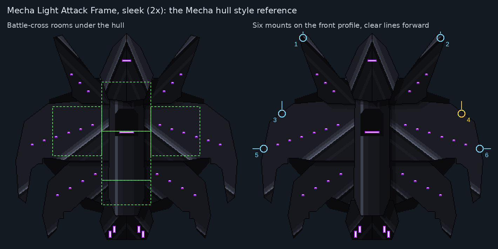

# Mecha Light Attack Frame, pixel redo

**Date:** 2026-10-25
**Status:** **accepted by Ship Designs: the current Mecha Light Attack Frame.** The battle-cross hull, floor plans,
weapons and armed previews in `battle-cross/` and `weapons/`. They replaced the earlier vector frame and vector
weapons; those, and the pixel rounds before the battle cross (versions A and B, curved plates, faceted blades), were
removed on 2026-10-26 and are in git history.

## What it is

The Mecha frame in the Mecha style (`docs/art/README.md`): pixel art drawn pixel by pixel, in the Mecha palette
(`docs/art/palette.md`), with purple only in the light slits.

- **Inspiration:** the design language of FTL's Lanius ships (big overlapping plates, hooked and pointed tips, dark
  machinery between the plates, rows of glowing slits). Nothing is copied or recoloured from them: the shapes are
  drawn new, around this ship's own rooms.
- **Matched to the Mecha console** (`../../console/`): the spine is drawn like the console's tower, and the plates
  have stepped notches like its cheeks.
- **No caution stripes and no boxy panelled deck**, as heromedel asked.

## Tools

| File | What |
|---|---|
| `tools/hull_bc_sleek.py` | Builds the battle-cross hull: `python3 hull_bc_sleek.py OUT_DIR` |
| `tools/floor_bc.py` | Builds the floor plans: `python3 floor_bc.py OUT_DIR` |
| `tools/weapons_px.py` | Builds the weapons and armed previews: `python3 weapons_px.py OUT_DIR` |
| `tools/pixel_svg.py` | Writes pixel art as compact SVG (one path per colour, each row's runs merged), used by every tool here. `python3 pixel_svg.py FILE.svg ...` compacts an old one-rect-per-pixel SVG in place. On 2026-10-26 every SVG here was compacted this way (about 14 times smaller) and checked to render pixel for pixel the same. |
| `docs/art/tools/render.js`, `sheet.js` | Shared: SVG to PNG (`node render.js in.svg out.png [scale] [background]`) and review sheets |

## Battle cross (2026-10-25): the Mecha hull style reference

heromedel re-planned the rooms first: the **battle cross** (5 rooms, 20 tiles: a command deck with Piloting, Shields
and Doors at the bow; the Servicing Core at the heart; a weapon bay on each flank, the port one spare for a second
weapon or dock; Engines and Life Support sharing the stern room). `battle-cross/` is the B style rebuilt around it at
340 × 300, one hull for both loadouts. The six mounts are hidden data, with no hardpoint drawn on any of them (the
weapon art marks its own mount). They follow FTL's mount data (checked in its layout files): each sits on the hull's
outer edge, on the front profile so nothing of the ship is ahead of it, and stores its slide direction (`data-slide`):
1–2 on the horn tips and 3–4 on the big blades' forward edges, sliding up (forward); 5–6 on the blades' outermost
flanks, sliding outward. Odd numbers port, even starboard. Mount 4, level with the starboard weapon bay, takes the
Hull Laser. The build checks the line ahead of each slid-out weapon is clear. No launch
opening is drawn for the Suit Dock.

**Sleek finish (heromedel: saved as the starting point to compare future Mecha hulls against).** The speckled grit,
seams, machinery blocks and conduit glints read as damage, so the surface was redone sleek: near-black metal (the main
tone is the Mecha palette's shadow grey `#1c1d24`) shaded in crisp bands, a bright highlight along each blade's ridge
falling off in steps, a dark crease and a faint reflected band below it, thin rim light on edges facing the upper-left
light, short clean shadows under overlapping plates, and the spine shaded like a polished column. The big blades' light
band is slimmed so their lights sit on dark metal; the rear highlights are thinner than the front ones. Purple stays in
the light rows, the spine slit, the bow slit (one band across the prow's centre line, on purpose) and four rear vents,
staggered along the engine block's dark band. Every light and vent has at least 2 px of one even shade around it
(art rules: detail passes; the build checks it). Built by `tools/hull_bc_sleek.py OUT_DIR` (the earlier speckled version is in git
history). `review-sheet.png` shows the rooms and the planned mounts.

Future Mecha hulls are compared against this one, but different ship styles should still look different, as not
every Terran ship is a rocket or a shuttle.

## Floor plans, weapons and loadouts (2026-10-25)

- **Floor plans** (`battle-cross/floor-plans/`, built by `tools/floor_bc.py`): a floor layer and a plan on the hull for
  each loadout, in the Mecha pixel style: a light deck so the dark crew read clearly, dark walls with a lit rim, steel
  door slabs, airlocks only in the floor plan (two, in the spare bay, never marked on the hull). Consoles are the
  Mecha tower (no ports) turned to face their wall, with the system symbol upright in Mecha power purple: Piloting and
  Shields on the command deck's front wall, Doors on its side, the weapon pod (Hull Laser) or EVB Dock console (Suit
  Dock) on the weapon bay's outer wall. The Servicing Core is a single tile (the core room's free corner), which
  crew walk over: heromedel's design from `mecha/servicing-core/` (a wall panel with the medbay symbol, two servicing
  arms and a stand table), always drawn upright, never turned. In the Suit Dock loadout the weapon bay has an airlock on its outer wall, on the tile next to
  the EVB Dock console (the dock sits next to an airlock; art rules); the Hull Laser loadout has no airlock there, as
  the weapon pod has nothing to do with airlocks. No conduits: every system carries its own power. The build checks
  every room sits under the hull, no console stands on a door tile, one console per tile, no system takes more than
  one tile, the EVB Dock is next to an airlock, every door joins two rooms and every airlock opens to space.
  - **2026-10-26 changes (heromedel's rules):** the Core's cradle went from two tiles to one, and the Suit Dock's
    launch clamp was removed in favour of the airlock beside the EVB Dock. Re-accepted by Ship Designs (78aa3d0).
  - **2026-10-26: new Servicing Core art** (heromedel's pick, `mecha/servicing-core/`) replaces the placeholder cradle
    (a medbay cross under a gantry) in every plan, armed preview and overview. Nothing else changed. Re-accepted by Ship Designs (2d544e3).
  - **Two frames (Ship Designs, agreed with heromedel; accepted 2026-10-25), same hull art, both loadouts** (`frames.png`):
    - **Standard** (`plan-standard-*`): the stern split into two 2 × 1 rooms with a door between, Engines in the
      port room and Life Support in the starboard room. The Core's door opens into the engine room.
    - **Open stern** (`plan-open-stern-*`), the alternate, more vulnerable frame: Engines and Life Support share one
      4 × 1 stern room (4 tiles so its two consoles and its door each get a tile), so a fire or breach there hits both.
  - The hull's shadowed body was widened a few pixels to cover the 4-tile-wide stern.
- **Weapons** (`weapons/`, built by `tools/weapons_px.py`), in the hull's sleek banded metal, purple only at the
  emitters: the **DS-ST Hull Laser** (a squat housing and two heavy barrels, one per shot) and the **laser
  battlesuit** (heromedel's HalfMech crew sprite with a laser on its right arm; its jump pack is on its back, out of
  sight from above). They replace the vector weapons in `docs/art/weapons/` (accepted).
- **Armed previews** (`battle-cross/mecha-bc-armed-*.png`, standard frame; overview in `battle-cross/loadouts.png`): the Hull Laser
  at mount 4, slid out from under the blade's edge (only the part past the edge shows, as when it slides out); the
  Suit Dock shown with its battlesuit just launched, off the starboard bow. The two loadouts look different.

## Next

Done: accepted by Ship Designs on 2026-10-25. Ship-design note from Ship Designs: Life Support shares the stern room
with Engines, so a fire or breach there hits both (a readable weak point).
