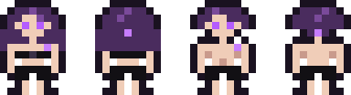

# HalfMech pilot (out of the suit)

**Date:** 2026-10-25
**Status:** heromedel's art, saved to the project for reference. There are no current plans for HalfMechs to ever be
out of their suits in the game. Source: https://claude.ai/artifact/TAqoUS9c2WW7HTYkkkkD5n

The petite pilot who lives inside a Mecha suit (race profile: the Mecha, HalfMechs), drawn top-down like the crew,
at about half an FTL human's size: about 9 px wide and 13 px tall, half the height of the 25 px Mecha suit.

- **Base designs** (`halfmech-pilot-base.*`): female and male, front and rear, 13 px tall. The top-down sheet was
  redrawn from them.
- **Implant lights** in purple: on her left shoulder (viewer-right when she faces down), and on the back of the head,
  seen only when she faces up.
- **Palette:** outline `#1a1220`, hair `#4a2c5e`, hair light `#7a4a9a`, skin `#f0cdb8`, skin shade `#c99a8c`, eyes
  `#b45cff`, clothes `#121014`, implant light `#c77dff`, tools `#6b6b78`.

## The sheet

`halfmech-pilot-sheet.*`: 315 × 455 px, 35 px cells, 9 columns by 13 rows, transparent background, laid out like an
FTL crew sheet.

| Row | Animations |
|---|---|
| 1 | Walk down, walk right |
| 2 | Walk up, walk left |
| 3 | Shoot down, shoot right, shoot up (her sidearm) |
| 4 | Fight fire down, fight fire right |
| 5 | Fight fire up, fight fire left |
| 6 | Repair (a 3-frame wrench loop, played three times) |
| 7 | Punch down |
| 8 | Type right, type left |
| 9 | Type up, type down |
| 10 | Teleport (pulled upward in uneven strands) |
| 11 | Clone / spawn |
| 12 | Shoot left, punch up |
| 13 | Portrait, death right |

## Files

| File | What |
|---|---|
| `halfmech-pilot-base.svg`, `-8x.png` | The four base designs |
| `halfmech-pilot-sheet.svg`, `.png`, `-3x.png` | The top-down crew sheet, at 1x and 3x |
