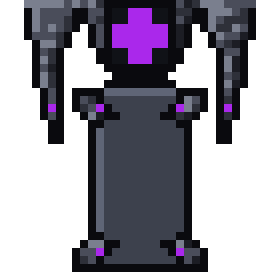

# Mecha Cybernetic Servicing Core

**Date:** 2026-10-26
**Status:** **picked by heromedel (option N)**, used in the Light Attack Frame floor plans
(`mecha/light-attack-frame/pixel-redo/`), accepted by Ship Designs. It replaced the placeholder cradle there (a medbay
cross under a gantry).

A stepped wall panel with a dark console-style screen holding the medbay symbol in Mecha power purple; two tapered
servicing arms hanging either side, each with a purple light inside it near its foot; a tall stand table between
them, clear of the arms, with four small flared shoulders, each with a purple light.

- **One tile, walkable:** a non-controlled system on one tile (art rules); it may look big, but crew walk over it.
- **Always faces up:** unlike other systems it is never turned (heromedel).
- Drawn in the Mecha console's shading and Mecha power purple.

**How it was picked:** heromedel chose from three first options (wall core and arms, clamp ring, service arch), then
asked for A's panel with C's arms and B's table, and refined it over several rounds: long tapered arms not touching
the table, four shoulders with a purple light each, a purple light inside each arm near its foot, a tall table with
smaller shoulders so it can be wider, and the core's light slit widened into a symbol screen. The option sheets are in
git history.

## Files

| File | What |
|---|---|
| `mecha-servicing-core.svg`, `.png`, `-8x.png` | The pick, on a 35 × 35 tile, at 1x and 8x |
| `tools/core_px.py` | Builds it (`servicing_core()`, used by the floor plan tool) and the option sheet: `python3 core_px.py ../../crew/mecha-crew-sheet.svg OUT_DIR` |
