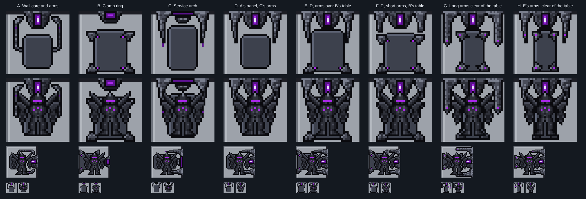

# Mecha Cybernetic Servicing Core (work in progress)

**Date:** 2026-10-26
**Status:** test options, not picked yet. heromedel asked for a new Mecha design for the Core, to replace the
placeholder cradle in the Light Attack Frame floor plans (a medbay cross under a gantry).

The Core is a non-controlled system on one tile (art rules): it may look big, but crew walk over it. The machinery
sits against the wall and round the edges; the middle stays a flat pad the HalfMech stands on. It turns to any wall,
like the Mecha console, and uses the console's shading and Mecha power purple.

| Option | What |
|---|---|
| A. Wall core and arms | a stepped housing on the wall with the core's light slit, two jointed servicing arms either side of the pad (recommended) |
| B. Clamp ring | a low core block on the wall, four clamp jaws at the pad's corners |
| C. Service arch | a stepped arch of armour over the pad, the core's light along its crown, a tool head over the shoulders |

**heromedel's mix (2026-10-26):** A's wall panel, C's arms and B's table. Unlike other systems, the Core always
faces up and is never turned. Two ways to fit them (`review/mix-tiles.png`, `review/mix-inroom.png`):

| Option | What |
|---|---|
| E | the arms reach down over the table's upper corners (its upper jaws left off) |
| F | shorter arms ending above the table, which keeps all four jaws |

| G | heromedel's notes on E: long arms stopping 2 px clear of the table, the table narrowed so all four jaws (shoulders) fit, a purple light on each jaw, and one near the foot of each arm, inside it, not on an edge pixel (the build checks the gap and the lights) |

| H | G redone with E's arms unchanged (heromedel: G's arms were changed too much and lost the taper): the table narrowed and its upper jaws made compact so the arms stay 2 px clear |

`review/e-vs-h.png`, `review/h-inroom.png` show H. `review/g-tile.png`, `review/g-inroom.png` show G. `review/inroom.png` shows each in the battle cross's core room, empty and with a HalfMech standing in it.

Built by `tools/core_px.py ../crew/mecha-crew-sheet.svg OUT_DIR`.
