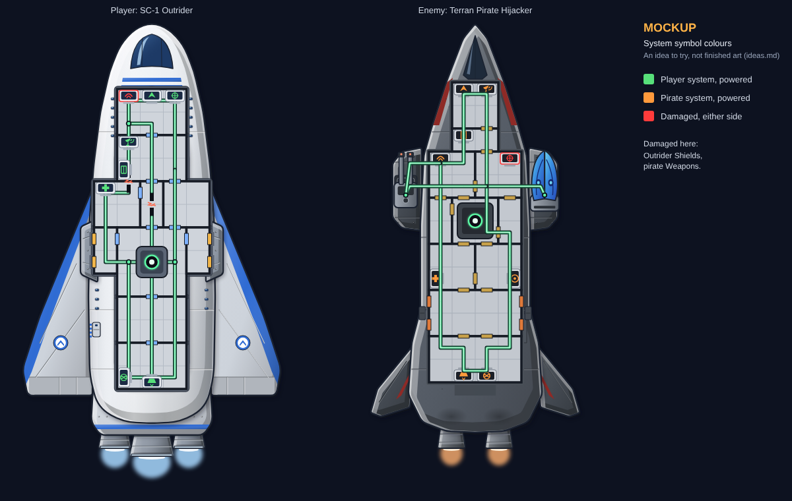

# MOCKUP: system symbol colours (2026-10-23)

**A mockup of an idea, not finished art.** The idea is in `docs/ideas.md`, "Ship interior art", Proposed:
heromedel's colour code for system symbols.

| Colour | Meaning | Here |
|---|---|---|
| Green `#57e07a` | Player system, powered | the Outrider (floor layout test 4) |
| Orange `#ff9a3c` | Pirate system, powered | the pirate Hijacker (its floor plan) |
| Red `#ff3b3b` | Damaged, either side | the Outrider's Shields, the pirate's Weapons (red symbol and a red rim on the desk) |

Made with the real floor plan tools; only the symbol colours change. The Outrider half comes from floor layout
test 4, itself a test, so it keeps that test's cut conduits.

**Things to look at:**

- The player's green symbols sit close to the green conduit glow. A different green, or a different conduit colour,
  may read better.
- GDD 14B (power systems coloured like FTL's, Proposed) uses orange for damage, where this idea uses it for the
  pirate side.
- Other enemy races: share the orange, or each get a colour.

Rebuild: `python3 mockup.py OUT.svg [GREEN ORANGE RED]`, which also takes other colours to try.
