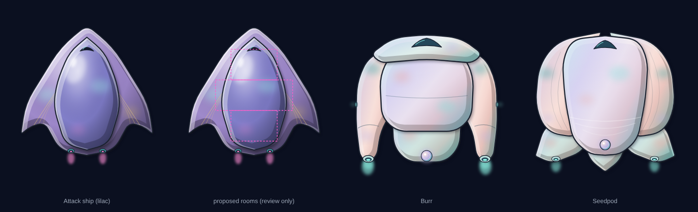

# Tentauri attack ship hull

**Date:** 2026-11-14
**Status:** lilac colours picked by heromedel (2026-11-14); sent to Ship Designs. **Ai-Generated-Proposal:** no
Tentauri attack ship is designed yet, so its rooms below are a proposal too.

## What it is

- **Hull only:** no hint of airlocks or weapon mounts, no weapons drawn, no floor plan. `tentauri-attack-ship-hull.svg`,
  360 × 430, nose up, light from the upper left.
- **A barbed arrowhead seed:** a broad lilac shell with a softened nose and two hooked barbs trailing at the rear
  corners, a domed periwinkle seed plate with the canopy, gold veins running to the barbs, and two thrusters glowing
  Tentauri pink at the stern. Broad and flat, never a rocket.
- **Shaped by its job** (heromedel asked whether an attack ship would look like the Burr): the Burr is wide and
  chubby with outriggers, the Seedpod round and wrapped, the attack ship one sharp, broad form pointing forward. The
  soft, organic finish is what they share.
- **Rounder** (heromedel, 2026-11-14: the ships read "flat on flat"): each plate has dome shading (bright upper left,
  darker toward its edges); the seed plate has a soft gloss and casts a deeper shadow, so it bulges from the shell.
- **Colours** (`review/colours.png`): lilac abalone picked. Opal dusk (dusty rose, pale violet, teal sheen) is kept
  for a less aggressive Tentauri ship (heromedel). Also tried: Tentauri pastel, seafoam, and the first dark indigo.
- **Proposed rooms** (`review/room-check.svg`, review only), a cross: Bow 3×2 (-1,-3)–(1,-2), Main 5×2 (-2,-1)–(2,0),
  Stern 3×2 (-1,1)–(1,2): few rooms, many systems (race profile). Every room plus 4 px is solid hull.

## How it was made (the 3-6 rule)

- **Concepts round 1** (`review/concepts-round1.png`, a 3×7 layout): devil's claw (pincers), lance (a rocket),
  thistle (a mushroom), sickle (horns). All dropped; the narrow layout forced a capsule.
- **Concepts round 2** (`review/concepts-round2.png`, the cross layout): double samara (an egg with wings),
  **barbed arrowhead (picked)**, glider (a plain kite), joined claws (still pincers).
- **Versions** (`review/versions.png`): as drawn, soft nose, **soft nose with a seed plate (picked)**, hooked barbs.
- **Passes** (`review/passes.png`): gold ribs; a slimmer seed plate and canopy; the plate's nose set back; softer
  barbs and thrusters moved in; a longer stern so the rooms fit. Then dome shading and the colour round.

## Files

| File | What it is |
|---|---|
| `tentauri-attack-ship-hull.svg`, `.png`, `-2x.png` | The hull (lilac) |
| `review/stages.png` | The five stages |
| `tools/attack_ship.py` | Builds the hull, stages, room check and other schemes: `python3 attack_ship.py OUT_DIR [opal pastel seafoam]` |

**For the Godot version**, if a ship file is made with these rooms:
`<art hull="tentauri-attack-ship-hull-2x.png" scale="0.5" center="180,218"/>`.
