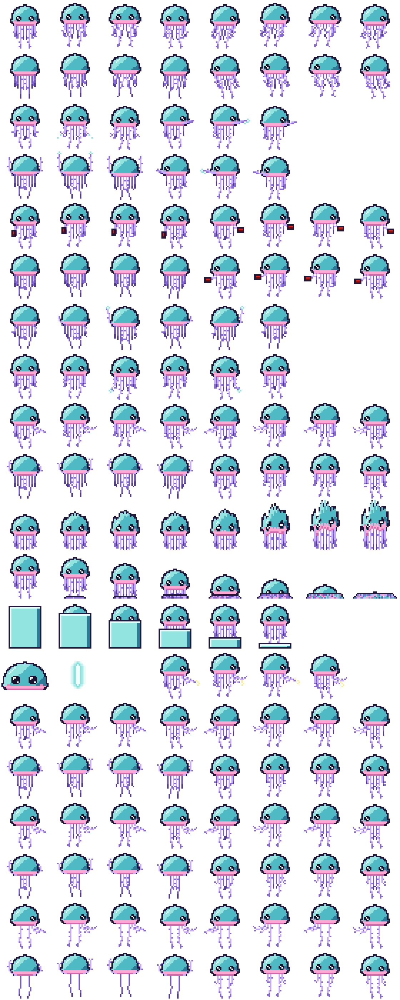

# Tentauri crew sprite sheet

**Date:** 2026-10-25
**Status:** heromedel's sheet and reach prototype, saved as the reference for Tentauri crew. Sources:
- Sheet: https://claude.ai/artifact/JxheWdQk6QJDtxcp6wcu7L
- Reach prototype: https://claude.ai/artifact/RZGZgFGBDQ5Jrs55PTJGeV

A soft jellyfish seen from above: a teal bell with a highlight and dark outline, two dot eyes, a pink rim at the base,
and lavender tentacles. The two long tentacles always hang. Only the eight short ones type, shoot, punch or reach out
to other systems.

280 × 700 pixels: 35 × 35 frames, 8 per row, 20 rows. Rows 1–14 follow FTL's crew sheet layout.

| Row | Frames |
|---|---|
| 1 | Float down, then float right |
| 2 | Float up, then float left |
| 3 | Shoot down, then shoot right |
| 4 | Shoot up, then shoot left |
| 5 | Fight fire down, then right |
| 6 | Fight fire up, then left |
| 7 | Punch up (tentacle whip) |
| 8 | Punch down (tentacle whip) |
| 9 | Type right, then type left |
| 10 | Type up, then type down |
| 11 | Teleport |
| 12 | Death (melts from the tips up) |
| 13 | Clone |
| 14 | Portrait, crew laser shot, repair |
| 15 | Typing with 1 other system: right, left |
| 16 | Typing with 1 other system: up, down |
| 17 | Typing with 2 other systems: right, left |
| 18 | Typing with 2 other systems: up, down |
| 19 | Typing with 3 other systems: right, left |
| 20 | Typing with 3 other systems: up, down |

## Reach prototype

[`tentauri-reach-prototype.html`](tentauri-reach-prototype.html) is a self-contained page. The Tentauri types at its
own console and grows a pair of short tentacles to up to three more consoles in the same room, two per console, so
all eight short tentacles are in use. The tentacles are drawn live at sprite resolution (2 px thick, lavender
`#c8aaff` with `#886ad6` shading, `#765ac4` frills and a `#e2fffa` tap highlight). They wiggle, take about 0.9 s to
grow out, and each pair taps alternately like two hands. A tentacle pulls back in when its console is disconnected.

[`tentauri-reach-body-sheet.png`](tentauri-reach-body-sheet.png) is the body sheet embedded in the prototype:
280 × 280, indexed by direction × tentacles out (0–3) × bob frame.

## Files

| File | What |
|---|---|
| `tentauri-crew-sheet.svg` | The sheet, one path per colour |
| `tentauri-crew-sheet.png`, `-4x.png` | Renders at 1x and 4x |
| `tentauri-reach-prototype.html` | Tentacle-to-system reach prototype |
| `tentauri-reach-body-sheet.png` | The prototype's body sheet |
