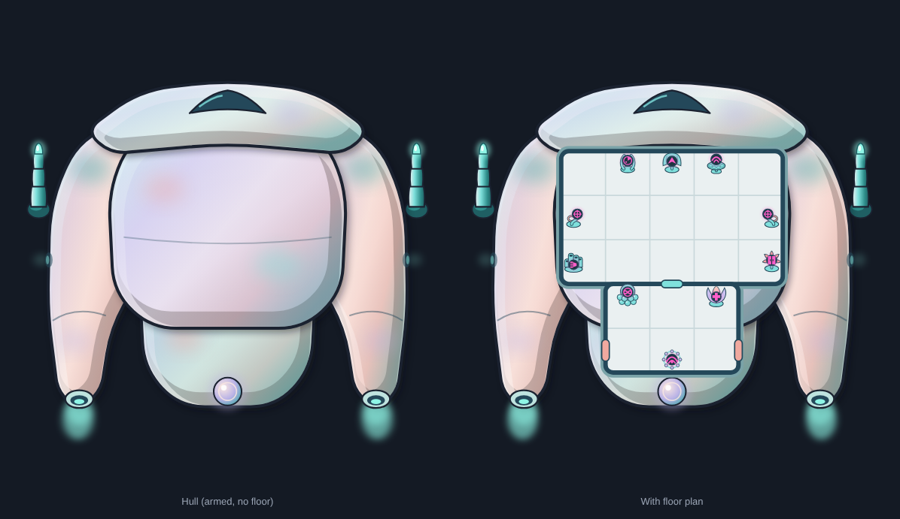

# Tentauri scout

**Date:** 2026-10-23
**Status:** accepted by Ship Designs, including the later changes (segmented Defense Laser, edge mounts, organs on the
walls; re-accepted 2026-10-25). Ship design: `docs/ship-suggestions.md`, "Tentauri Tough Little Scout" (a
working label, kept off the art).

## What it is

A small, wide, organic scout for the shielded race: soft, chubby and safe-looking (heromedel), and clearly not
Terran. Prismatic mother-of-pearl colours, light from the upper left.

- **Hull only** in `tentauri-scout-hull.svg`: top-down, nose up, 340 × 380. `tentauri-scout-hull-mounts.svg` and
  `review/mounts.png` show the six hidden mounts (2026-10-26, art rules), each on the outer edge with a clear line
  forward and its slide direction; odd port, even starboard: 1–2 on the front plate's leading edge (sliding up), 3–4
  on the flank plates' outer edges (the two Defense Lasers), 5–6 on the front plate's tips. The lasers sat about
  18 px in, on the flank plates, until then.
- **Plates:** a broad aqua front plate with a single canopy, a lavender dorsal plate, fat coral flank lobes and a teal
  rear module. The Supershield Generator shows as a pearl organ at the stern.
- **Propulsion:** a nozzle at the tail of each flank lobe, plus side thrusters, set wide apart. No engine bells. The
  side thrusters were toned down on 2026-10-26 (a dim, soft vent), so they don't read as marked airlocks (art rules).
- **Weapons** are separate art: the Defense Laser in `docs/art/weapons/defense-laser/`. The armed preview
  (`tentauri-scout-armed-preview.*`) places one at each fitted mount, slid 12 px out and under the hull.
- **Scale:** `review/scale.png` shows it at true scale beside the Terran Outrider, and zoomed out on the enemy side.

## Floor plan

`floor-plan/`: the floor layer on its own (`tentauri-scout-floor.*`) and the plan on the armed hull
(`tentauri-scout-plan.*`). Biomechanical, so there are no conduits and no conduit layer.

| Room | Size | Systems |
|---|---|---|
| Forward | 5×3 | Sensors, Piloting, Shields, Weapons A and B, Engines, Doors |
| Rear | 3×2 | Life Support, Medbay, Supershield Generator |

- One door between the rooms and an airlock on each flank of the rear room. No console sits on a door tile (the
  build checks this). No spare rooms, as the art rules ask for the Tentauri.
- **Consoles:** instead of monitors, each system is a small organic base growing from a soft pad, with the standard
  system symbol lit green in a dark bulb (heromedel's sketch). Each system has its own base, shaped by what it does:

| System | Base |
|---|---|
| Sensors | grasp: three fingers cupping the bulb, like a viewing screen |
| Piloting | hood: a membrane hood standing behind the bulb |
| Shields | carapace: a domed shell of plates on a short stand |
| Weapons A and B | trigger: a hooked grip with a coral ring; the starboard one is mirrored |
| Engines | pipes: soft open tubes, like a pipe organ |
| Doors | iris: coral petals, a valve that opens and closes |
| Life Support | air sacs in a cluster, the bulb set in a soft collar |
| Medbay | bud: half-open petals cupping the bulb |
| Supershield Generator | halo: a ring of beads round the bulb |

- **On the wall (2026-10-25):** each base is half size, upright and slid against the wall of its tile (never turned
  or mirrored for the wall), so a Tentauri floats and works on the console's own tile, as the art rules ask. The
  symbol is shrunk less, to 80%, so it stays legible. Tested first in a 2×2 room with the crew sheet (Test C).

## History

- **Hull:** 15 versions (version sheets in git history). Egg, snowman, jellyfish, mushroom and helmet shapes were dropped.
  heromedel's advice fixed it: plan the rooms first, then shape the hull, and spread the thrusters apart, on the sides
  or on wings. v13 (the fat outrigger) was picked over a slimmer pass.
- **Consoles:** monitors were replaced by organic bases after heromedel's sketch. The grasp was the first favourite
  ("gorgeous"); heromedel then asked for one base per system. Rounds for Medbay, Life Support, Engines and Shields are
  in git history (the option sheets). Piloting took the hood, and Shields got the carapace, raised on a stand.
- **Symbols:** the Engines, Sensors and Doors symbols were redrawn for every ship during this piece (side-view jet,
  radar scope, door slabs).

## Tools

| File | What it does |
|---|---|
| `tools/tentauri.py` | Builds the final hull (v13) and its stages: `python3 tentauri.py OUT_DIR` (the other versions' code is in git history) |
| `tools/tentauri_weapons.py` | Builds the Defense Laser: `python3 tentauri_weapons.py OUT_DIR` |
| `tools/tentauri_floor.py` | Builds the floor layer, armed preview and plan: `python3 tentauri_floor.py ../tentauri-scout-hull.svg OUT_DIR` |
| `docs/art/tools/` | Shared: `art_kit.py` (drawing kit), `render.js` (SVG to PNG), `sheet.js` (review sheets), `check_mounts.py` (the mount check) |
