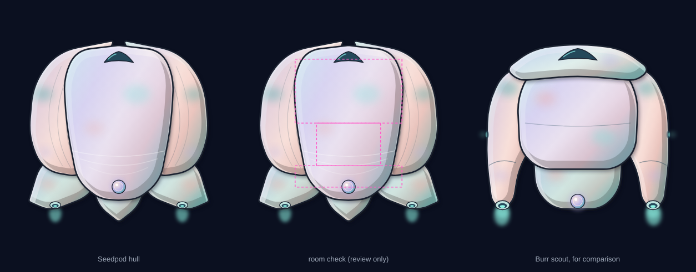

# Tentauri Seedpod hull

**Date:** 2026-11-14
**Status:** saved by heromedel (2026-11-14); not yet sent to Ship Designs or the Godot version.
Ship: the Tentauri Seedpod, id `tentauri-warden` (`infall-godot/content/ships/tentauri-warden/ship.xml`), with the
Chestnut loadout. Its description there: "pillowy and prismatic, wrapped in shields. It means to pass, not to destroy."

## What it is

- **Hull only** (heromedel, 2026-11-14): no hint of airlocks or weapon mounts, no weapons drawn, no floor plan (floor
  plans are now data). `tentauri-seedpod-hull.svg`, 360 × 400, nose up, light from the upper left.
- **A closed bud:** two coral petals wrap the flanks from the stern to the bow, where their tips nearly meet; a pearly
  lavender dorsal plate with a single canopy between them; three teal sepals cup the stern. Soft thrusters sit in the
  side sepals, wide apart, and the pearl Supershield organ at the tail.
- **Unlike the Burr scout** (broad front plate, outrigger arms with nozzles at their tips): one rounded, wrapped
  form. Same Tentauri finish (`style-guides.md`): pastel mother-of-pearl, soft mottling, the scout's palette.
- **Rooms first:** the Forward (5×3), Middle (3×2) and Rear (5×1) rooms from the ship file, on 35 px tiles. Every
  room plus a 4 px margin is solid hull (checked on the render; `review/room-check.svg` shows the rooms, review only).

## How it was made (the 3-6 rule)

- **Concepts** (`review/concepts.png`): A husk cradling a seed (the leaves read as detached tongs), **B closed bud
  (picked)**, C lotus head (read as a mushroom, dropped on the Burr before), D split pea pod (the gap cut through
  the forward room).
- **Versions** (`review/versions.png`): v1 plain, v2 pointed petals, **v3 pointed petals with a calyx (picked)**,
  v4 calyx alone.
- **Passes** (`review/passes.png`): 1 thrusters set into the sepals (they floated in v3); 2 a narrower dorsal plate
  so the petals show; 3 shorter, inward petal tips; 4 petal veins and growth lines; 5 calmer mottling and a smaller
  canopy; then the sepals widened inward to close a gap at the rear room's corners.

## Files

| File | What it is |
|---|---|
| `tentauri-seedpod-hull.svg`, `.png`, `-2x.png` | The hull |
| `review/stages.png` | The five stages: outline, fill, shade, highlight, details |
| `review/hull-and-rooms.png`, `review/room-check.svg` | The hull, the room check and the Burr for scale |
| `tools/seedpod.py` | Builds the hull, the stages and the room check: `python3 seedpod.py OUT_DIR` |

**For the Godot version:** `<art hull="tentauri-seedpod-hull-2x.png" scale="0.5" center="180,205"/>` (tile (0,0)'s
centre). Mounts are coordinate points in the ship file, not art.
