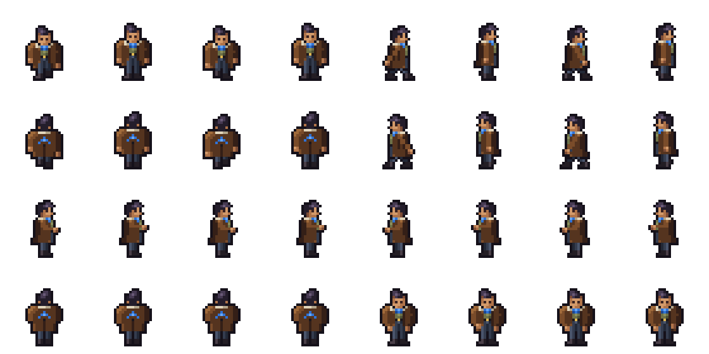
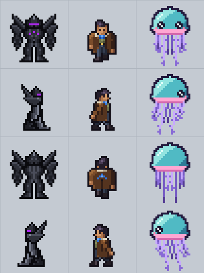

# Terran crew test 3: the drifter in a duster

**Date:** 2026-11-09
**Status:** a test, waiting for heromedel's verdict. Made in one sitting without questions, to see whether a Terran
can be drawn to sit beside the Mecha and Tentauri crew sheets. Everything about the look is an
**Ai-Generated-Proposal (2026-11-09)**.

A Terran seen from about 45 degrees above (the 1/2 view): a dark quiff, a brown duster with a fleece collar, a
GATOS-blue bandana at the neck, an olive shirt, dark trousers and boots, and a blue scout chevron on the coat's back.
The bandana and the chevron are the one accent, as purple is for the Mecha.

- **Decided (heromedel, 2026-11-10):** this drifter keeps the chevron, but it is his own emblem: there is no
  universal Terran or Tabby emblem, and other Terrans will wear other emblems.
- **Proposed (heromedel, 2026-11-10):** the hands are fists of four pixels (they were flat, two pixels wide and one
  tall).
- **Proposed (heromedel, 2026-11-10):** he stands 23 pixels tall, two shorter than the Mecha in its suit (he was 26,
  a pixel taller than it). A row came out of the chest, one out of the coat's skirt and one out of the legs.

280 × 140 pixels: 35 × 35 frames, 8 per row, with the boots on the same line as the Mecha's feet. The rows follow
the other sheets' order for the rows that exist:

| Row | Frames |
|---|---|
| 1 | Walk down, then walk right |
| 2 | Walk up, then walk left |
| 3 | Type right, then type left |
| 4 | Type up, then type down |

Not drawn yet: shooting, fighting fire, punching, teleport, death, clone, portrait and repair.

## How it is made

Every pixel is placed by hand as text, one character a pixel, in `tools/drifter.py`; the colours are in
`tools/pix.py`. A frame is a few parts laid over each other (legs, then the upper body), and a walking frame drops the
upper body a pixel when a foot lands. No filter, blur, outline pass or scaling touches the picture. Left-facing frames
are the right-facing ones mirrored. `python3 tools/build.py`, run from this folder, rebuilds the sheet and the
pictures in `review/`.

## Review pictures

- `review/game-size.png`: the three races standing, at game size, 2x and 4x.
- `review/walk-1x.gif`, `walk-2x.gif`, `walk-4x.gif`: all three walking in the four directions.
- `review/console-1x.gif`, `console-2x.gif`, `console-4x.gif`: all three at a console.
