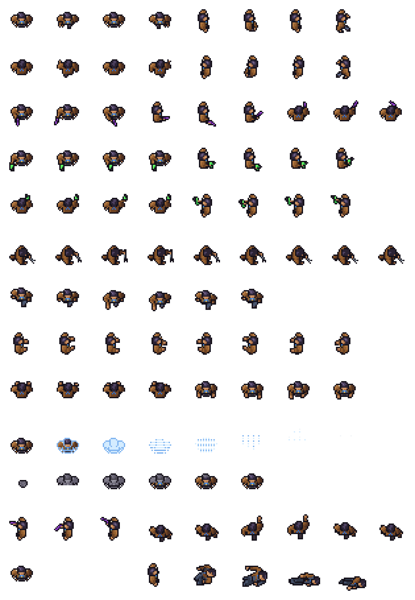
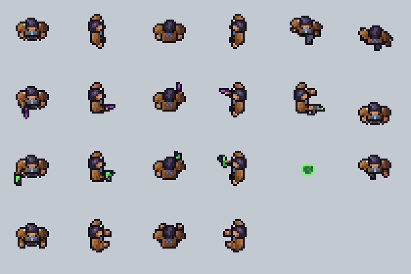

# Terran crew test 4: the drifter from above, at the genre's size

**Date:** 2026-11-10
**Status:** a test, waiting for heromedel's verdict. It is the first of the three versions agreed on 2026-11-10:
this one at the genre's size and build, then an extended one with more pixels for the coat, then the face-forward
drifter of crew test 3 revisited. Everything about the look is an **Ai-Generated-Proposal (2026-11-10)**.

The drifter of crew test 3, seen from almost straight above and built the way the genre builds its human
(`docs/reference/genre-crew-sheet-analysis.md`): a head on two coat shoulders on a two-line torso, a fist a pixel,
feet a line.

- His **brown duster** is the two shoulders and the sleeves, with a cream pixel of fleece collar beside the head.
- His **quiff** is the head: dark hair with its highlight to one side and a single row of face under it.
- The **blue bandana** is three pixels in the middle of the torso line. From behind, the **chevron** is three blue
  pixels on his back.
- The **coat's tail** facing the camera is two brown pixels beside his feet; when he steps, the one on the stepping
  side is covered (heromedel's "two brown dots that kick back when he steps"). **From behind it is a hem**: a third
  brown line under his back that hides his feet, with a boot showing only when he steps. (The two dots from behind
  read as an X: heromedel, 2026-11-10.)
- The **pistol is metal in Mecha purple** and the **extinguisher is power green** (heromedel, 2026-11-10).
  **Proposed (heromedel, 2026-11-10):** the extinguisher could take the power colour of whichever race is using it.
- The pistol and the extinguisher are in his right hand at the end of a straight arm. His head stays still when he
  aims: only the arm and pistol move (heromedel, 2026-11-10).

## The sheet

315 × 455 pixels: 35 × 35 frames, 13 rows of up to 9, **laid out exactly as the genre's human sheet is**, with the
same frame counts:

| Row | Frames |
|---|---|
| 1 | Walk down (4), walk right (4) |
| 2 | Walk up (4), walk left (4) |
| 3 | Aim down, right, up (3 each: straight, a little to his right, a little to his left; no flash) |
| 4 | Fire down (4), fire right (4): the green extinguisher swept from side to side, no spray |
| 5 | Fire up (4), fire left (4) |
| 6 | Repair (9 frames from 3 drawings, played 1 2 3 3 2 2 1 1 1) |
| 7 | Punch down (6) |
| 8 | Type right (4), type left (4) |
| 9 | Type up (4), type down (4) |
| 10 | Teleport (9: his edge lights up, he turns all to light, and the light thins into bands, columns and rising sparks; the last frame is empty) |
| 11 | Clone (6: a grey lump, a grey figure, the colour coming in from the feet) |
| 12 | Aim left (3), punch up (6) |
| 13 | Portrait (the standing frame), crew laser shot (a white bar), a gap, death (5, from the side) |

- **Decided (heromedel, 2026-11-10):** the sheet's teleport is the light one, first made for crew test 3. The
  genre's kind, where his own pixels are pulled upward, is kept beside the sheet as the alternative:
  `terran-drifter-topdown-teleport-pulled.png` (9 frames in a row). `review/teleport-compare.png` shows both.

## How close it sits to the genre's sheet

It was drawn frame for frame against the genre's sheet, working from letter maps of where each of its parts sits in
each frame. Measured afterwards, frame against frame in the same place on the sheet:

- **No pixel has the genre's colour** except the white laser bar, which is plain white on both.
- **The outlines nearly coincide on almost every row:** 92–98% of the shape is shared on the walk, aim, fire, punch
  and type rows, **97% on death and 100% on repair**. Those last two were first drawn as my own poses; heromedel
  found the repair senseless ("a severed hand or a vulture") and the death "dumb" (2026-11-10), so both now take the
  genre's poses part for part, in his colours. This is the closest the project has come to the genre's own drawing.
  heromedel decides whether that is the right side of the repo's rule (likeness and design may match exactly; lifting
  the art files is forbidden), and whether this sheet stays a study or goes in the game.
- **Two rows are worked out and share little of their shape:** the teleport, which is now the light one and unlike
  the genre's, and the clone (66%). Walking
  away shares 86%, because of the hem.

## How it is made

Every frame is placed by hand as text, one character a pixel, in `tools/topdown.py`; the colours are in
`tools/pix.py`. An action frame is the standing grid with the rows of the acting arm replaced. Two things are worked
out from drawn frames instead of drawn: the teleport (his own shape turned to light and thinned out) and the clone
bay's greys. `python3 tools/build.py`, run from this folder,
rebuilds the sheet and the pictures in `review/`.

## Review pictures

- `review/animations-2x.gif`, `animations-4x.gif`: every animation looping. Row 1: walk down, right, up, left, punch
  down, punch up. Row 2: aim down, right, up, left, repair, teleport. Row 3: fire down, right, up, left, clone,
  death. Row 4: type down, right, up, left.
- `review/game-size.png`: the face-forward drifter of crew test 3 beside this one facing down, right, up and left,
  at game size, 2x and 4x.
