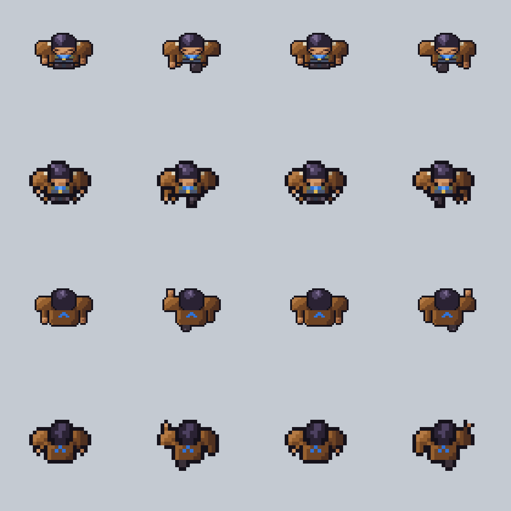

# Terran crew test 5: the drifter from above, at twice the size

**Date:** 2026-11-10
**Status:** set aside (heromedel, 2026-11-10): at this size it takes too much work to stop it looking derpy, so
the work goes back to the small sheet of crew test 4. Kept as a record of what was tried. It was in progress when
stopped: Asked for by heromedel on 2026-11-10: now that crew test 4 has the style and the view,
redo it at twice the size so the outlines can be cleaned and thinned and there is room for shading and details,
and so it stops being a copy of the genre's drawing. Every frame is to be redrawn by hand, one at a time; nothing is
enlarged or thinned automatically. Everything about the look is an **Ai-Generated-Proposal (2026-11-10)**.

Rows 1 and 3 are this version; rows 2 and 4 are crew test 4 enlarged to the same size on screen.

70 × 70 frames. What is different from the small one:

- **One thin outline.** The black line is one pixel of a 70-pixel frame, half as heavy as before.
- **No black inside the coat.** Where two parts of the same cloth meet (shoulder and sleeve, sleeve and body) the
  line is dark brown, not black. Black is kept for the edge of him and for where one part sits over another (his
  head over his shoulders).
- **Shapes are rounded by hand**: the head, the shoulders, the fists (three by three) and the boots.
- **Room for the coat**: from behind it hangs seven rows below his shoulders, and the chevron is a clean mark.
- **A face with features.** heromedel, 2026-11-10: at the higher resolution "blocks not suggesting real facial
  features becomes more noticeable"; the first face was four rows of plain skin and looked melted. It now has a
  forehead, eyes in the shadow of the brow, a nose and a mouth. The rule for every part at this size: a block has to
  suggest the real thing it stands for.
- **Nothing moves that should not.** The second step of each walk is drawn again, not mirrored, so the light stays on
  his left and his hair's highlight does not jump (heromedel, 2026-11-10). The head is the same pixels in every
  walking frame.

## Drawn so far

| Done | Frames |
|---|---|
| Yes | Standing: facing the camera, right, away |
| Yes | Walk down (4), walk up (4) |
| Not yet | Walk right and left; aim; fire; repair; punch; type; teleport; clone; death; portrait and shot |

`tools/big.py` holds every frame as text, one character a pixel; `python3 tools/build.py`, run from this folder,
rebuilds the pictures in `review/`.
