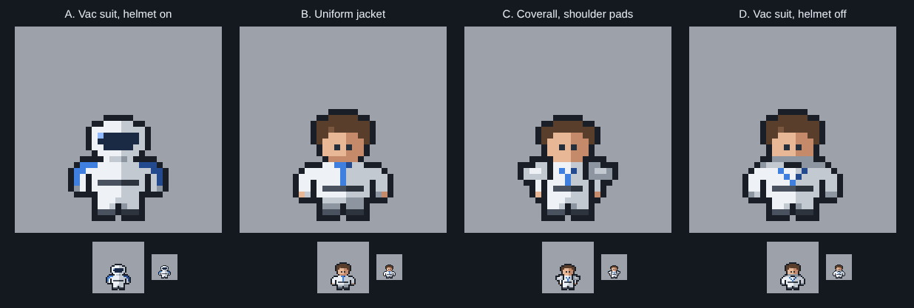

# GATOS (Terran) crew

**Date:** 2026-10-26
**Status:** first concepts for heromedel to pick from. **Ai-Generated-Proposal:** the race docs don't yet say how
Terran crew look, beyond "a loose alliance of humans" (race profiles, Terrans) and the doing-well colours of their
ships (white and pale grey with blue trim).

One standing frame each, facing down, on the 35 × 35 crew tile, at 8x, 2x and true size. Drawn new, not from FTL's
human sprite: GATOS white and blue, light from the upper left.

| Concept | What |
|---|---|
| A. Vac suit, helmet on | a round helmet with a dark visor, blue shoulder trim, grey gloves and boots |
| B. Uniform jacket | bare head, white jacket with a blue collar and a blue stripe down the front |
| C. Coverall, shoulder pads | armoured shoulder pads and a blue harness, wider at the shoulders |
| D. Vac suit, helmet off | a thick neck ring and a blue chevron on the chest (the Outrider's roundel mark) |

Built by `tools/crew_concepts.py OUT_DIR`.
