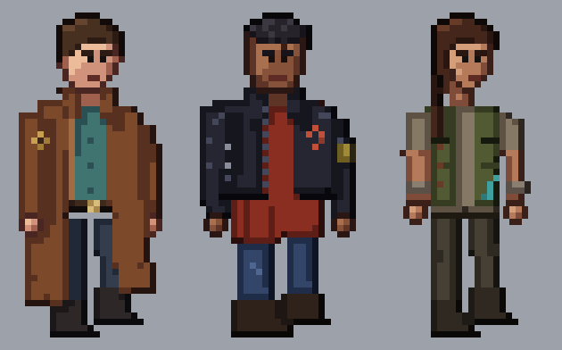

# GATOS (Terran) crew

**Date:** 2026-10-27
**Status:** round 1, three options for heromedel. **Ai-Generated-Proposal** in every detail, built on heromedel's
direction (2026-10-27): pants, dark boots, a mid-tone shirt and a jacket, a rough look; a subtle mix of a space
alliance, a Mexican gang and a 1980s punk gang (no mohawks), as if the GATOS were an alliance of legal and sometimes
benevolent Terran gangs; leaning leather jackets and long-coated mercs, with Firefly as one style inspiration; no
spacemen, nothing cute or cheesy, no stereotypes. 3/4 view. Each person has their own emblem, not one alliance mark.

| Option | Look | Emblem |
|---|---|---|
| 1. Long-coat drifter | brown leather duster to the shins, teal shirt, dark trousers and boots | a faded gold diamond on the near shoulder |
| 2. Leather jacket | cropped black leather jacket over a long faded red shirt, rolled jeans, heavy boots, a bandana on the arm, cropped hair, a brow scar | a painted rust-red broken circle on the chest |
| 3. Vest merc | canvas utility vest over a dusty shirt with rolled sleeves, forearm wraps, cargo pants, a long braid | a stitched teal fish hook on the vest |

Drawn at 2x (a 70 × 70 frame, the figure about 52 px tall, four heads). `review/gatos-crew-round1-stages.png` shows
the build stages (silhouette, flat colours, shading, highlights with selective outlines, details), then each at 2x,
at true 2x size and halved to 35 px. Bodies are shapes shaded by rule (light from the upper left, colour ramps that
shift warmer in the light and cooler in the shade); heads and hands are placed pixel by pixel. Earlier spacemen
concepts were rejected and are in git history.

Built by `tools/sheet.py crew1 crew2 crew3 OUT.svg` and `tools/trio.py crew1 crew2 crew3 SCALE OUT.svg` (run from
`tools/`).
