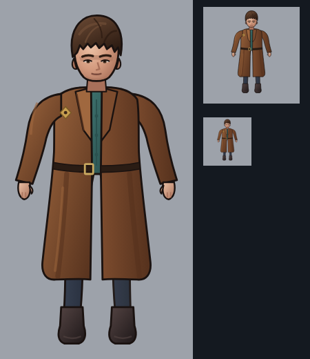
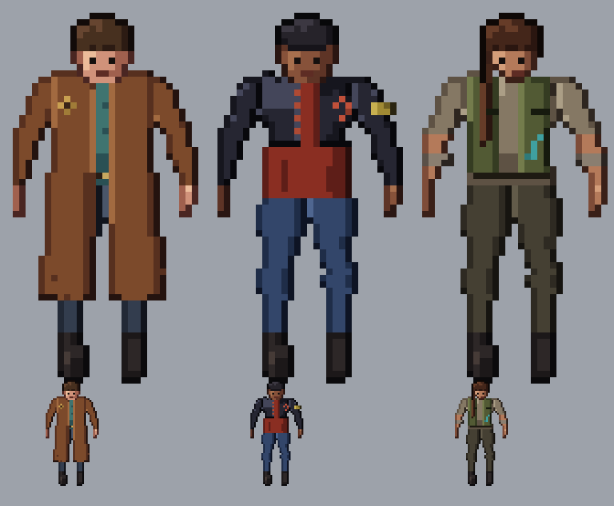

# GATOS (Terran) crew

**Date:** 2026-10-27
**Status:** round 5 (experiment, not pushed), three options for heromedel. **Ai-Generated-Proposal** in every detail, built on heromedel's
direction (2026-10-27): pants, dark boots, a mid-tone shirt and a jacket, a rough look; a subtle mix of a space
alliance, a Mexican gang and a 1980s punk gang (no mohawks), as if the GATOS were an alliance of legal and sometimes
benevolent Terran gangs; leaning leather jackets and long-coated mercs, with Firefly as one style inspiration; no
spacemen, nothing cute or cheesy, no stereotypes. Facing forward, seen from about 45° above (heromedel's "1/2"
angle), upright enough to sit with the Mecha and Tentauri crew. Each person has their own emblem, not one alliance mark.

**Round 5 as SVG (2026-10-27):** `svg/gatos-drifter.svg`, `gatos-leather-jacket.svg`, `gatos-vest-merc.svg`: the
round 5 pixel art exported pixel for pixel, nothing changed (one path per colour; the viewBox is the 70 × 70 frame, so
they scale to any size with crisp pixels; checked: every pixel matches). Built by `tools/export_svg.py OUT_DIR`.

**Reference rigs (heromedel, 2026-10-27):** `reference/heromedel-rig-male-standing-idle-step.png` and
`reference/heromedel-rig-female-standing-idle-step.png`: a male and a female model, each standing, idle and mid-step,
seen from the front, right side and back, with joints and the shirt, trouser and boot edges marked. For use as needed:
body proportions (female and male), idle and walking poses, and side and back views for later animation frames.

**Drifter at 2x, one goal at a time (experiment, 2026-10-27; `docs/art/sprite-process.md`):** rebuilt by
`tools/hires2.py OUT_DIR` from the round 5 pixels with a part map (every pixel labelled: coat, belt, lapels, buttons,
buckle, emblem, eyes, mouth, boots…). Each goal may only change its own parts and is checked by `tools/qa.py`
(details survive and still stand out, no change outside the goal's parts, no stray pixels, no holes, matched pairs
symmetric; `python3 qa.py --selftest` rebuilds the old mistakes, including the whole-image blur, and catches each).
`review/gatos-drifter-2x-rounds.png`: the 2x blocks, after round 1, after round 2. Result: `svg/gatos-drifter-2x.svg`.

| Round | Goal | Check |
|---|---|---|
| 1 | softer coat and sleeve shading (coat and sleeves only) | pass, belt/buttons/lapels kept |
| 1 | one-sub-pixel outline: coat, hair, face, legs, hands, each separately | pass |
| 1 | belt darker with a lit strap edge, brighter buckle rim | pass (belt contrast 42 → 45) |
| 1 | matched boots | pass (shapes identical) |
| 1 | jaw tapering to a rounded chin, eyes with lids, whites and irises, a thin mouth | pass |
| blind 1 | named him right ("a man in a long brown coat"); found: boots like flower pots, no neck, pupils to one side, a pale jaw patch, jagged sleeves, block hands, the skirt lit evenly | |
| 2 | boots with toes turned out, a toe cap and a sole; a neck; centred eyes; a cleaner jaw; smoother sleeve edges; hands with fingers; the far skirt in shade | all pass |
| blind 2 | boots now read as boots ("clearly boots"), the neck and eyes no longer flagged; still weak: the hands (square blocks, no thumb), boxy arms and shoulders, short legs under the coat, the jagged lower-left hem, flat coat shading | round 3 |
| 3 (heromedel) | darker palette; a charcoal-olive henley instead of the teal dress shirt; a leather patch with a pale slash instead of the flower-like diamond | self-test fixed: a belt blurred into the coat's main tone is caught again |
| 3 | boots: trousers tucked into the shaft (no gap), a narrow ankle, the foot a pixel wider below it, its top lit, toes at the viewer | `attached` yes, `boot_forward` 0 px off, shapes identical |
| 3 | hands hanging from the cuff: taller than wide, thumb on the body side, finger lines down | `hand_hangs` pass on both |
| 3 | a forehead (the fringe lifted off the brows, ragged), the face's shadow turning instead of a hard half split, brows a row higher, eyes two rows tall with a light lower lid | pass |
| 3 | the coat and sleeves redrawn as shapes (`tools/coat3.py`): sloped round shoulders, a slight waist, a skirt flaring to a curved hem, sleeves hanging beside the body, shading by form (one light, cooler shadows, warmer lights, drop folds of different lengths and angles from the belt, cast shadows under the belt and beside the sleeves) | pass |
| blind 3 | named right ("a man in a long brown trench coat", "a coated spacer"); boots attached, toes forward, not duck feet; hands hang (still mitten-like). Still flagged: a slightly sleepy look, the face's light/shadow split, the coat body a bit barrel-shaped, skirt panels reading as two tubes, long vertical stripes. 5/10 | |

| 3b (heromedel: arms too straight, like fists at his sides; pencil legs with a crotch bulge; a long mouth; a dark spot under the eye) | the sleeves bend a little at the elbow so the forearms angle in and the hands rest in front of the coat's sides; the legs drawn bare first (`tools/legs3.py`: thighs meeting at the crotch in a soft V, knees, calves swelling below them, ankles into the boots), then the coat put back on over them; a shorter mouth; the lower lid lighter | pass |
| blind 3b | arms "relaxed and hanging, not stiff or angry"; no pencil legs or crotch problem. Still flagged: a slightly sleepy, soft face; wide puffy shoulders; mitten hands. 5/10 | |

Tried and dropped in round 3: shading by regions (the skirt's lower half a step darker, then with a checker seam, then
following the folds) made visible squares and bands (heromedel); an ordered dither over the whole coat read as
checkerboard noise. `review/gatos-drifter-2x-round3.png`: round 2 beside round 3; `review/gatos-drifter-2x-round3b.png`:
the review sheet of round 3b.

**At the Mecha crew's size (round 3c, 2026-10-28):** `tools/small.py` brings the 2x drifter down to a 25-pixel-tall
figure in a 35-pixel frame as pixel art (each pixel takes the part covering most of its cell, in that part's colour,
snapped to the sprite's own palette). Two outline styles to compare, beside the Mecha crew in
`review/gatos-drifter-mecha-size-outlines.png`: **A** (`svg/drifter-small-clean.svg`) keeps the figure's own edge
with the one-pixel stair-step corners taken off; **B** (`svg/drifter-small-black.svg`) is a slightly smaller figure
with a one-pixel black line all round, drawn without doubled corners, like the Mecha crew's.

**Round 3d (2026-10-28):** heromedel asked for the outline to be fixed on the full-size drifter first and then scaled
down. `review/gatos-drifter-game-size-versions.png` shows the 2x drifter and the same drifter with a thick black outline
(`small.thick_outline`, 5 px, so it comes down to one pixel), then at game size beside the Mecha crew: the plain
downscale, the downscale of the outlined one (tidied by `small.tidy_outline`: gaps closed, corner-only pixels
dropped, one pixel everywhere), and the drifter drawn by hand at game size (`tools/tiny.py`, `svg/drifter-tiny.svg`;
blind-checked seven times, last 6/10, still flagged: sleeves and hands read weakly, the hem corners, a heavy gap
between the legs; then, heromedel: no nose, and the trench coat's ruffled hem flattened). Version B above (black outline added after shrinking) was rejected: "it clearly sucks".

**Typing, facing the viewer (round 3e, 2026-10-28):** `tools/type_anim.py` makes four frames from the 2x drifter, as
the crew sheets' "type down" rows do: both hands down, the near hand lifted, both down, the far hand lifted
(`svg/drifter-2x-type-down-0.svg` … `-3.svg`, `review/drifter-2x-type-down-strip.png` and `.gif`). As in those rows,
the elbows go out to the sides and the hands come down at the hips, palms down, pressing in turn (a lifted hand rises
3 px with the fingers curled); the head dips a pixel with the eyes lowered. No console in the sprite: the console is
room art, and the crew stands on its tile (a console mockup tried first was wrong, heromedel, and is removed). Blind
check: reads as working only weakly without the console, and would bring the hands together in front; kept as the
crew sheets do it unless heromedel prefers otherwise.

**Back and side views, and typing in every direction (round 3f, 2026-10-28):** `tools/views.py` draws the 2x drifter
from behind and from the right (left is the mirror image), from heromedel's rig renders
(`review/drifter-2x-views.png`). Back: the head all hair over a strip of nape, the collar up, the belt all round, a
vent up the skirt; the hands and lower sleeves are hidden, since they hang in front of the coat (heromedel). Side:
the head in profile, the coat's front edge with the lapel, the buckle at the front, the near arm hanging over the
coat with the back of the hand to us (heromedel), the legs one behind the other, boots in profile over the legs.
`tools/type_anim.py` makes the four typing frames for each direction (`svg/drifter-2x-type-{down,right,up,left}-0..3.svg`,
`review/drifter-2x-type-sheet.png` and a `.gif` per direction): down as before; right with both forearms reaching
forward at chest height, the far one behind him and darker; up with the elbows out and the hands raised beside the
shoulders, the backs of the hands to us.

**Faster tries:** `python3 tools/review.py OUT_DIR` builds the sprite with every goal and check and writes one review
sheet (the figure enlarged, at 2x and true size, and close-ups of the head, a hand and the boots), in about 3 seconds.

**Drifter at 2x resolution (experiment, 2026-10-27):** `svg/gatos-drifter-2x.svg` (140 × 140), built by
`tools/hires.py drifter OUT.svg` from the round 5 pixels: each pixel becomes a 2 × 2 block, then the outline thins to
one sub-pixel, one-pixel stair-steps on the silhouette lose their outer corner, and the shading gains in-between
tones (each 4-tone ramp becomes 7, each sub-pixel a soft average of its neighbours snapped to that ramp); the face keeps
its hand-placed pixels. `review/gatos-drifter-2x-compare.png`: round 5 (left) beside it (right).

**Vector test (experiment, 2026-10-27):** heromedel: the pixel versions look flat, with beady eyes and shading so
contrasty it reads as embossed panels; try higher resolution or vectors, from scratch, with rounder, subtler and more
anatomical shading. The drifter redrawn as a vector (`review/gatos-drifter-vector.svg`, built by
`tools/vector_drifter.py`) over the rig's joints: rounded shapes with soft, low-contrast gradients, a head at the 45°
view (the crown and parted, tousled hair above, the face lower and shorter), almond eyes with whites under a brow
shadow, a nose and jaw shown by shadow, sleeves that read apart from the coat, hands with thumbs, the coat's lapels,
belt and folds drawn as soft shapes. Shown large, at 2x and at true size (`review/gatos-crew-vector-test.png`).

**Round 5:** the same three outfits fitted to heromedel's rigged model (`reference/heromedel-rig-front-right-back.png`;
its front view, the 1/2 view, cut to `reference/rig-front-45.png`). The joint and clothing-edge marks are cleaned off
the picture; each pixel goes to its nearest bone (torso, upper and lower arms, thighs, shins, feet), hands start at the
wrists, the shirt ends at the model's hem line, and the clothing is placed by the joints (the duster reaches between
the knees and ankles). Built by `tools/show2.py OUT.svg` (`tools/rig.py`, `tools/paint2.py`, `tools/crews2.py`).
**Round 5, pass 2:** the duster shaded as a trench coat, from cloth-shading advice (folds start where the cloth
hangs from, shadow only along the fold lines, slightly bent lines, one light direction): lit shoulder tops, lapels
folded back with a shadow under their edge, a belt at the waist, one soft fold per panel hanging from the belt and
drifting outward as the coat flares, a lining line on the open front edge, the hem in shade. The boots are now one
matched pair, the same shape on both feet. Round 4 is kept below for comparison.

| Option | Look | Emblem |
|---|---|---|
| 1. Long-coat drifter | brown leather duster to the shins, teal shirt, dark trousers and boots | a faded gold diamond on the near shoulder |
| 2. Leather jacket | cropped black leather jacket over a long faded red shirt, rolled jeans, heavy boots, a bandana on the arm, cropped hair, a brow scar | a painted rust-red broken circle on the chest |
| 3. Vest merc | canvas utility vest over a dusty shirt with rolled sleeves, forearm wraps, cargo pants, a long braid | a stitched teal fish hook on the vest |

Drawn at 2x (a 70 × 70 frame, the figure 56 px tall), with a true-size copy under each. **Traced over heromedel's
45° render** (`reference/`: his camera-angle sheet and the 45° standing frame cut from it), so the angle and
proportions come from the model, not guesswork: the render is scaled to the frame and mirrored so the light comes
from the upper left; its outline gives the silhouette, and its smoothed lightness gives each region's shading (three
tones per material, warmer in the light, cooler in the shade). Coats, vests and the shirt tail are painted over it as
cloth panels; the heads are drawn by hand, a little larger than the model's (sprites exaggerate the head).
`review/gatos-crew-round4-stages.png` shows the stages: silhouette, flat colours, shading, highlights and outline,
details.

**Round 4 (heromedel: round 2's faces, with cleaner lines and better shading):** round 2's heads back; stray
single pixels in the shading cleaned up; arms and legs shaded as cylinders (base, with the far third in shade), so
the render's texture no longer shows as blotches; a lit left edge on each body part; a darker line where an arm meets
the body or one leg meets the other.

**Round 3, rejected (heromedel: worse; the square faces were worse)** (less derpy, a clean style with strong features, e.g. Batman: The Animated Series):** square,
angular heads with heavy flat shadow shapes, separate dark brows over the eyes instead of dot eyes, no drawn mouth
beyond a shadow, square jaws; the body shading flattened to one shadow shape and the base, with highlights only on lit
edges. Round 2 (the round, blobby faces and noisy shading) is in git history.

Round 1 (turned figures, which distorted the heads and feet) and the earlier spacemen concepts are in git history.

Built by `tools/show.py OUT.svg` and `tools/stages.py OUT.svg` (the outfits are in `tools/crews.py`).
