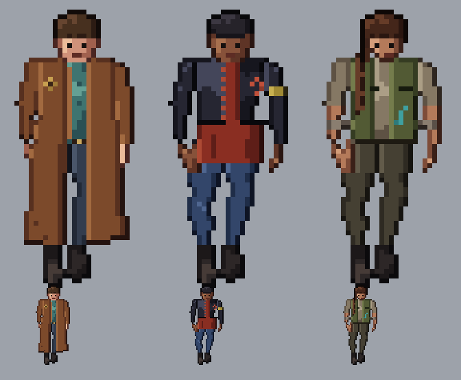

# GATOS (Terran) crew

**Date:** 2026-10-27
**Status:** round 4, three options for heromedel. **Ai-Generated-Proposal** in every detail, built on heromedel's
direction (2026-10-27): pants, dark boots, a mid-tone shirt and a jacket, a rough look; a subtle mix of a space
alliance, a Mexican gang and a 1980s punk gang (no mohawks), as if the GATOS were an alliance of legal and sometimes
benevolent Terran gangs; leaning leather jackets and long-coated mercs, with Firefly as one style inspiration; no
spacemen, nothing cute or cheesy, no stereotypes. Facing forward, seen from about 45° above (heromedel's "1/2"
angle), upright enough to sit with the Mecha and Tentauri crew. Each person has their own emblem, not one alliance mark.

| Option | Look | Emblem |
|---|---|---|
| 1. Long-coat drifter | brown leather duster to the shins, teal shirt, dark trousers and boots | a faded gold diamond on the near shoulder |
| 2. Leather jacket | cropped black leather jacket over a long faded red shirt, rolled jeans, heavy boots, a bandana on the arm, cropped hair, a brow scar | a painted rust-red broken circle on the chest |
| 3. Vest merc | canvas utility vest over a dusty shirt with rolled sleeves, forearm wraps, cargo pants, a long braid | a stitched teal fish hook on the vest |

Drawn at 2x (a 70 × 70 frame, the figure 56 px tall), with a true-size copy under each. **Traced over heromedel's
45° render** (`reference/`: his camera-angle sheet and the 45° standing frame cut from it), so the angle and
proportions come from the model, not guesswork: the render is scaled to the frame and mirrored so the light comes
from the upper left; its outline gives the silhouette, and its smoothed lightness gives each region's shading (three
tones per material, warmer in the light, cooler in the shade). Coats, vests and the shirt tail are painted over it as
cloth panels; the heads are drawn by hand, a little larger than the model's (sprites exaggerate the head).
`review/gatos-crew-round4-stages.png` shows the stages: silhouette, flat colours, shading, highlights and outline,
details.

**Round 4 (heromedel: round 2's faces, with cleaner lines and better shading):** round 2's heads back; stray
single pixels in the shading cleaned up; arms and legs shaded as cylinders (base, with the far third in shade), so
the render's texture no longer shows as blotches; a lit left edge on each body part; a darker line where an arm meets
the body or one leg meets the other.

**Round 3, rejected (heromedel: worse; the square faces were worse)** (less derpy, a clean style with strong features, e.g. Batman: The Animated Series):** square,
angular heads with heavy flat shadow shapes, separate dark brows over the eyes instead of dot eyes, no drawn mouth
beyond a shadow, square jaws; the body shading flattened to one shadow shape and the base, with highlights only on lit
edges. Round 2 (the round, blobby faces and noisy shading) is in git history.

Round 1 (turned figures, which distorted the heads and feet) and the earlier spacemen concepts are in git history.

Built by `tools/show.py OUT.svg` and `tools/stages.py OUT.svg` (the outfits are in `tools/crews.py`).
