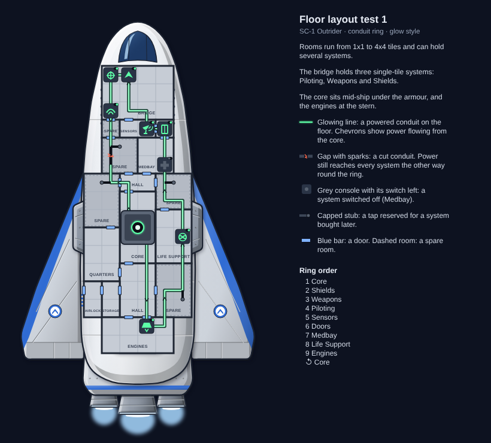

# Floor layout test 1 (2026-10-23)

**Ai-Generated-Proposal.** The first floor mockup for the SC-1 Outrider, made before looking at real FTL layouts.

- 30 px tiles; 17 rooms from 1×1 to 2×4.
- A 4×3 bridge holding Piloting, Weapons and Shields as single-tile consoles; every other system in its own room.
- The core room (2×4) mid-ship under the hull's armour cap; engines at the stern.
- The conduit ring from the core through every system and back, with one cut to show power arriving the other way,
  and Medbay switched off to show a system switch.
- Spare rooms marked with dashed outlines and capped conduit taps, plus Quarters, Storage and an Airlock room.

Conduit styles compared (`conduit-styles.png`): glowing green wire (picked, since lit versus dark shows power at a
glance), plain black cable, and twin rails like a train track.

What heromedel asked to change, leading to test 2: match real FTL layouts better; no marked spare areas, just blank
rooms; a simpler layout with no storage rooms; airlocks as doors going outside the ship.
