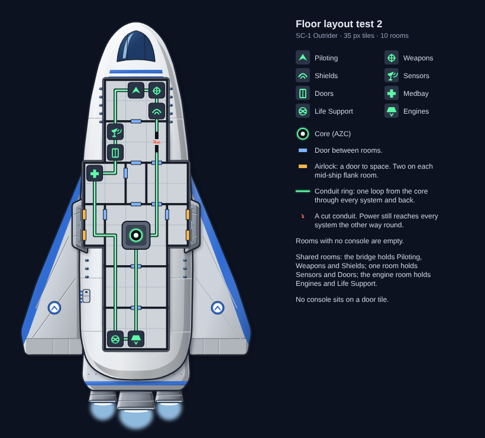

# Floor layout test 2 (2026-10-23)

**Ai-Generated-Proposal.** The SC-1 Outrider's floor plan, adapted from the Kestrel A's real layout turned nose up,
with nearby systems merged into shared rooms.

## Layout

35 px tiles, as in FTL: five tiles across mid-ship, three at the bridge, 13 rows long.

| Room | Size | Systems | Taken from the Kestrel A |
|---|---|---|---|
| Bridge | 3×2 | Piloting, Weapons, Shields | Nose pilot room and the room behind it, merged; Shields moved in from mid-ship |
| Sensors and Doors | 3×2 | Sensors, Doors | The doors and sensors rooms, merged |
| Medbay | 2×2 | Medbay | Medbay (same place, port side) |
| Corridor | 1×2 | — | — |
| Starboard forward room | 2×2 | — (empty) | The Kestrel's shields room, left empty since Shields moved to the bridge |
| Port and starboard airlock rooms | 1×2 each | — (empty) | The mid-ship flank rooms with airlocks |
| Core | 3×3 | AZC | Mid-ship centre, under the hull's armour cap |
| Aft hall | 3×2 | — (empty) | The small empty rooms around the Kestrel's weapons room |
| Engine room | 3×2 | Engines, Life Support | The engines and oxygen rooms at the stern, merged |

10 rooms in all, 5 of them empty. That is fewer than any FTL player ship (14–20), because three pairs of rooms were
merged and the layout was kept simple.

## Rules followed

- **Airlocks:** four doors to space, two on each mid-ship flank room, as on the Kestrel.
- **No console on a door tile:** the build checks this and stops if one does.
- **The conduit ring keeps Ship Designs' order:** core, Shields, Weapons, Piloting, Sensors, Doors, Medbay, Life
  Support, Engines, and back to the core. It runs up the starboard side and down the port side, so it never crosses
  itself. A cut on the starboard side shows every system still powered the other way round.
- **No marked spare areas:** empty rooms are simply blank.

## Notes for review

- The hull's airlock hatch detail (port side, aft of the wing root) no longer matches. These airlocks are mid-ship,
  beside the armour shoulders. If test 2 is kept, the hull's hatches move to match.
- Weapons and Shields sit on the bridge, as heromedel suggested, rather than in their own rooms as on the Kestrel.
- Life Support shares the engine room. FTL keeps oxygen in its own small room beside the engines.
