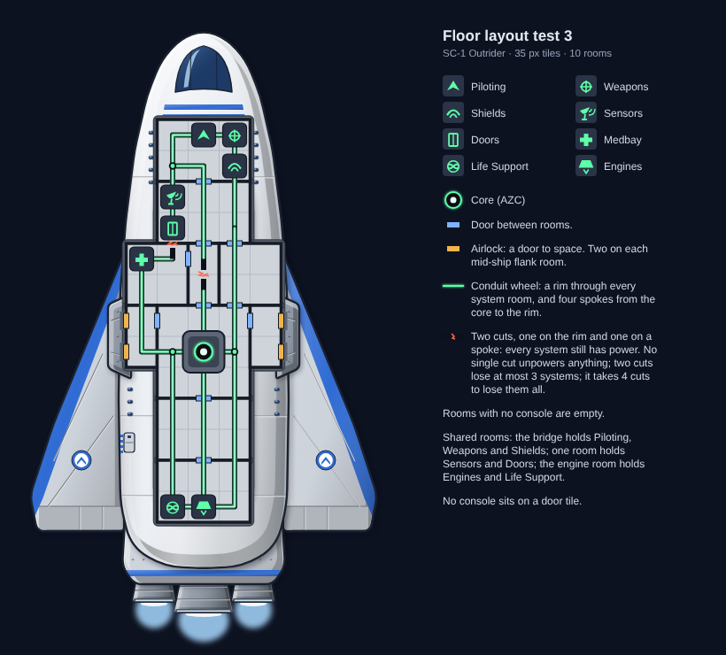

# Floor layout test 3 (2026-10-23)

**Ai-Generated-Proposal.** Test 2's rooms with the conduits redrawn as a wheel, so the Outrider is easy to reroute.

## Why

In test 2 the conduit ring left the core by only two exits, so two cuts beside the core unpowered every system with
no way to reroute. heromedel spotted it, and Ship Designs agreed the design text had the same weak point. Ship
Designs proposed the wheel, and heromedel chose to try it.

## The wheel

- **Rim:** a loop through every system room, so every system has two paths to power. Mid-ship it passes the core on
  both sides, through the core room, forming the ring around the core.
- **Spokes:** four from the core to spread-out points on the rim:
  - forward, up the middle to the bridge;
  - port and starboard, to the rim beside the core;
  - aft, down the middle to the engine room.
- Green dots mark where a spoke meets the rim.

## Tested, not assumed

`tools/floor3.py` cuts every conduit segment, then every pair, then every set of three, and checks which systems
lose power before it draws anything:

| Check | Result |
|---|---|
| Conduit segments | 44 |
| Systems unpowered by any single cut | none |
| Most systems lost to any two cuts | 3 |
| Fewest cuts that unpower everything | 4 |

The demo shows two cuts at once, one on the port rim between Doors and Medbay and one on the forward spoke. Every
system stays powered.

## Unchanged from test 2

Rooms, doors, airlocks and consoles are the same as test 2 (see `../test-2/README.md`).
