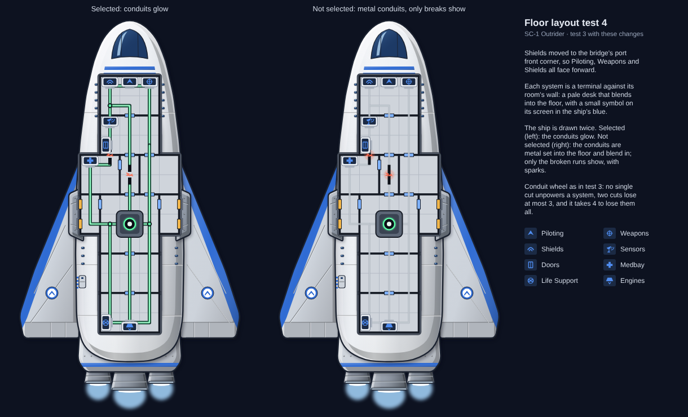

# Floor layout test 4 (2026-10-23)

**Ai-Generated-Proposal**, except where tagged. Test 3 with Shields moved forward, the conduits shown in two views,
and systems drawn as terminals. The ship is drawn twice: selected on the left, not selected on the right.

## Changes from test 3

- **Shields forward:** heromedel's suggestion. Shields moved to the bridge's port front corner, so Piloting, Weapons
  and Shields all face forward. The conduit wheel still passes it, and the power checks are unchanged: no single cut
  unpowers a system, two cuts lose at most 3, and it takes 4 to lose them all.
- **Conduit views:** **Proposed (2026-10-23)** in `docs/ideas.md`. heromedel suggested unbroken conduits either
  vanish when the ship isn't selected, or are metal conduits blending into the floor unless broken. This test
  shows the second option:
  - **Selected:** the conduits glow green.
  - **Not selected:** pale metal set into the floor. Only the broken runs show, with a red glow and sparks.
- **Terminals:** **Proposed (2026-10-23)** in `docs/ideas.md`. A system is two things: a blended graphic and a small
  symbol on it in one of the ship's colours. Each system is a pale wall desk against its room's wall, with a dark
  screen showing the system's symbol in the hull's trim blue. The core keeps its own machine graphic.

## Terminal styles considered

| Style | Verdict |
|---|---|
| Wall desk with a sloped screen | **Picked.** Hugs the wall, blends into the floor, and the symbol reads at real size. |
| Rounded console pod with a seat | Busy, and the seat reads as a second object. |
| Flat floor panel | Reads as a hatch, not a machine. |
| Wall bank with status lights | The symbol is too small at real size. |

## Unchanged from test 3

Rooms, doors, airlocks and the conduit wheel's route.
