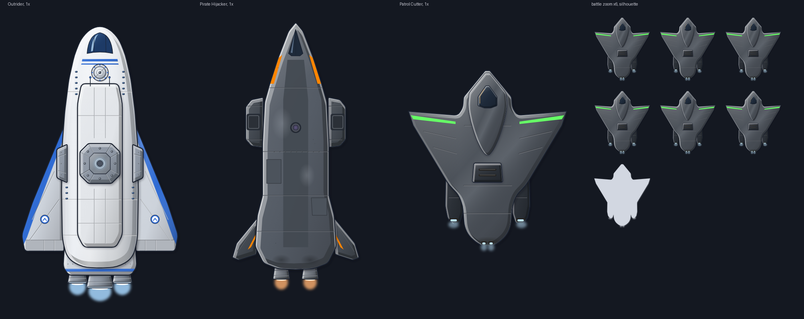

# GATOS Patrol Cutter hull

**Date:** 2026-11-13
**Status:** round 2, draft for heromedel's review, not yet sent to Ship Designs. The ship comes from the Godot version
(`infall-godot/content/ships/patrol-cutter/ship.xml` on `Cloud-C-Godot-Version`), which has no hull art for it; the
Checkpoint loadout (`loadout.patrol-cutter.checkpoint.xml`) uses the same hull.



## What it is

**Round 2 (2026-11-13).** heromedel on round 1 (a clean white shuttle): the rooms already make it nearly rocket-shaped;
the GATOS are a loose alliance of mercenaries, not a clean, white, Federation-like or "American clean-cut" vessel; go
for a merc look with wings or nacelles, and since it's a cutter, give it a sharp look, maybe sharp wings.

A rugged mercenary cutter: hull only, top-down, nose up, light from the upper left, 440 × 470 at 1x (35 px tiles, the
centre of tile (0, 0) at 220, 235).

- **Shape:** one hull outline for the body and its forward-swept blade wings, sharp at the tips and joined to the body
  with a smooth fillet, so it reads as one ship and breaks up the vertical stack of rooms; a chisel bow; engine
  nacelles under the wings' trailing edges with their nozzles set into their tapered tails, and a stern that curves
  in to a narrow tail with a small pair of nozzles set into it. No nose cone, fins or engine bells.
- **Colours and wear:** the Pirate Hijacker's gunmetal greys, a tad darker, with a metallic sheen and a pale rim (heromedel); the wings
  shade into the body on a smooth gradient, darker toward the tips. A stripe raked along each wing's leading edge in
  the ship's power colour: power green on a player ship, pirate power orange on a non-player one
  (`review/player-and-non-player.png`; the SVG is the player's, and the game swaps the one colour). Soft scorching aft.
  Nothing drips, and nothing on the hull marks where an airlock is. The AZC sits under a flush armoured
  panel with two vent slits.
- **Rooms first:** the 9 rooms of the ship file are laid out on the tile grid (`tools/layout.py`) and the hull is drawn
  round them; `tools/check_rooms.py` checks every room has at least 4 px of hull round it
  (`review/rooms-and-mounts.png`).
- **Six mounts** in the hidden `weapon-mounts` group, each placed on the edge measured from a render of the hull, with
  a clear line forward (`check_mounts.py`), odd port, even starboard: 1–2 on the wingtips, 3–4 on the wings' leading
  edges by the body (the Gat 2.1 at 3, the Gat M1 at 4; the Checkpoint fits the Gat 3.1 and the Gat M2 there), 5–6 on
  the bow's chines. All slide forward.
- **Parts:** `hull` (body and wings), `cockpit-module`, `nacelle-port`, `nacelle-starboard`, `cockpit`, `azc`, `engines`.

For the Godot ship file (art pixels on the 1x hull):

```xml
<art hull="patrol-cutter-hull-2x.png" scale="0.5" center="220,235"/>
<mount id="1" x="30" y="116" slide="up"/>
<mount id="2" x="410" y="116" slide="up"/>
<mount id="3" x="116" y="123" slide="up"/>
<mount id="4" x="324" y="123" slide="up"/>
<mount id="5" x="174" y="61" slide="up"/>
<mount id="6" x="266" y="62" slide="up"/>
```

## How it was made (`docs/art/ship-art-process.md`)

**Round 2:** concepts round the same rooms on a wider canvas (`review/concepts-round2.png`): W1, swept-back wings with
wingtip nacelles; W2, forward-swept wings with root nacelles (picked: the sharpest and least like anything vertical);
W3, crescent wings.

| Pass | Changes |
|---|---|
| 1 | The worn merc palette; the wing roots moved forward to cover the Shields room and Medbay; a narrower stern; mounts placed on the measured edge. |
| 2 | Blind check, 6/10 ("lived-in merc" reads; sharp only half-reads; the stubs read as landing legs; the octagon as a pasted-on turret): a chisel bow; the nacelles widened into the wing roots with chunky nozzles; the AZC under a flush armoured panel; a simpler canopy; the wing's patch panel dropped. |
| 3 | heromedel: the wings and the centre as one ship, not a column; no airlock-looking rectangle (hulls never show where airlocks are); the nozzles joined to the nacelles. One hull outline with a fillet at the wing roots, the wings a darker panel with no root line; the replaced panel at the bottom right removed; every nozzle set into its nacelle's tail or the stern. |
| 4 | heromedel: the Pirate Hijacker's grey, more metallic, the wings and centre blended so it doesn't read as a column, the stripes in power green (pirate orange on non-player vessels). Its gunmetal palette, a sheen and a pale rim; the wings' darker tone as a smooth gradient instead of a panel with an edge; the rust bands now power-colour stripes. |
| 5 | heromedel: a tad darker, and the cockpit set apart from the wings so it reads as a small cockpit. The greys a step darker; the cockpit a raised, bevelled nose module of its own, its rear edge curving across in front of the wing roots. |
| 6 | heromedel: sleekly down from the wings, not so harsh. The cockpit as a raised teardrop fairing tapering back down the spine between the wing roots, with a thin outline, a gentle bevel and only a hint of shadow. |
| 7 | heromedel: the back end tapering down more stylishly. From just behind the engine room the stern curves in to a narrow tail, with the stern nozzles set into it; the wings' trailing edges sweep into it on softer fillets; the nacelles' tails taper to match. |

Each part is built in the five stages (`review/stages.png`). The Gat M1 has no weapon art yet, so there is no armed
preview.

**Round 1 (rejected):** a clean white shuttle with swept sponsons, six passes (in git history; its concepts in
`review/concepts-round1.png`).

## Files

| File | What it is |
|---|---|
| `patrol-cutter-hull.svg` | The hull, with named parts and hidden mounts |
| `patrol-cutter-hull.png`, `-2x.png` | PNG exports at 1x and 2x, transparent |
| `patrol-cutter-hull-mounts.svg` | Review copy showing the mount spots |
| `tools/build.py` | Builds the hull and its stages: `python3 build.py OUT_DIR` |
| `tools/layout.py`, `tools/check_rooms.py` | The rooms on the pixel grid, and the room-margin check |
| `tools/concepts.py`, `tools/concepts2.py` | The concept silhouettes, rounds 1 and 2 |
