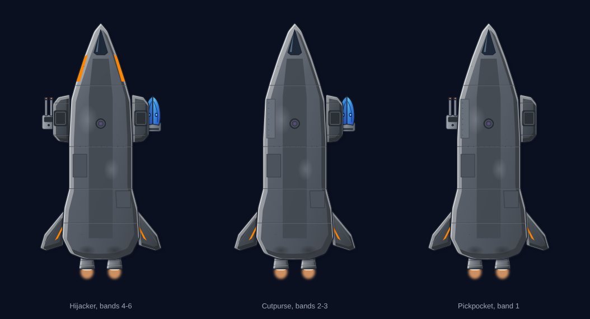
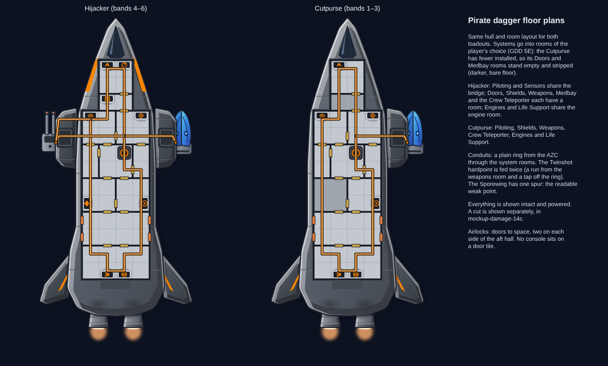

# Terran Pirate Hijacker hull (Hijacker and Cutpurse loadouts)

**Date:** 2026-10-23
**Status:** accepted by Ship Designs (version 3 of the review, the dagger cruiser); the 2026-10-26 art-rule fixes (one-tile AZC, six edge mounts, no hull hatches) re-accepted (7b5b613). Ship design: `docs/ship-suggestions.md`,
"Terran Pirate Hijacker" and "Pirate Hijacker loadouts".

## What it is

A doomed-Terran pirate cruiser: clean and restrained, in dark gunmetal with a single accent in pirate power orange
(`#FF8500`; oxblood until 2026-11-13, heromedel). One hull, two
loadouts. The side weapon bays are modules that come with the loadout (**Ai-Generated-Proposal**, accepted by Ship
Designs):

| Loadout | Bands | Bay modules | Weapons | Look |
|---|---|---|---|---|
| Hijacker | 4–6 | both bays | Twinshot (port), Sporewing (starboard) | pirate-orange nose stripes |
| Cutpurse | 2–3 | starboard only; port bay faired over flush | Sporewing | plainer, no stripes, leaner and lopsided |
| Pickpocket | 1 | the Cutpurse hull (Ship Designs, 2026-10-29) | Twinshot on mount 3 (on the faired-over port bay), no Sporewing | as the Cutpurse; `pirate-pickpocket-armed-preview.*` |

- **Hull only** in `pirate-*-hull.svg`: top-down, nose up, 480 × 760. Weapon mounts are hidden points in the
  `weapon-mounts` group. The weapons are separate art in `docs/art/weapons/` (`sporewing/`, `twinshot/`).
- **Six planned mounts (2026-10-26, art rules):** each on the hull's outer edge with a clear line forward, storing its
  slide direction (`data-slide`): 1–2 on the nose chines, 3–4 on the weapon pods' outer flanks, 5–6 on the fin tips
  (odd port, even starboard; `mounts.png`). The Hijacker fits the Twinshot at 3 and the Sporewing at 4; the Cutpurse
  fits the Sporewing at 4, and its mount 3 sits on the faired-over port bay. Before, the two weapons sat about 21 px in,
  on the pods' hardpoint rings.
- **Previews** in `pirate-*-armed-preview.*` place the weapon files at the mounts, at 1.35× their file size, slid
  12 px out in the mount's slide direction and drawn under the hull, so only the part past the edge shows.
- **Wear,** kept sparing: soft scorching behind the engines and weapon ports, faded paint, a little pitting, and two
  replaced plates in a slightly different shade. Nothing drips.
- **Fittings:** a narrow swept canopy, a dorsal teleporter emitter and two engines. The flank airlock hatches and
  the two dorsal hatches were removed on 2026-10-26 (art rules: no marked exterior doors); the airlocks are in the
  floor plan.
- **No emblem.** There is no standard GATOS emblem (Decided), and heromedel's review asked for none or a small one.

## History

The first design (rejected by heromedel, 2026-10-23) was cluttered: rust streaks, a cat-skull emblem, a fanged nose
maw, and the stolen launcher clamped on as a moth with roots. Its loadouts looked the same. heromedel: "that ship
is hideous, cluttered, the rust seems to drip but things don't drip in space, gatos are not cats, the weapon looks
bolted in place and weird, it's almost dumb and cheesy compared to FTL and it looks like the same hull and weapons."
That design was not kept. Its lessons are in `docs/art/README.md`. ("Gatos are not cats" was said before the
setting `GATOS Species: Terrans > Tabbys`; with Terrans they still aren't, with Tabbys they are.)

This design started fresh. Concepts considered:

- **Chined dagger cruiser with side bays:** picked; a classic, predatory cruiser shape, unlike the Outrider.
- **Twin-boom:** busy at squad zoom.
- **Hammerhead boarding prow:** read as alien.
- **Pincer ship:** cheesy.
- **Retrofitted box freighter:** no threat.

Versions: the dagger (picked), the dagger with canards, and a stepped hull (the versions sheet and alternates are in git history).

| Pass | Changes |
|---|---|
| 1 | Hull widened 30% to hold a mid-tier ship's rooms; stronger oxblood accents on the nose chines and fins. |
| 2 | Weapons drawn, Sporewing style picked, previews composed from the separate weapon files. |
| 3 | Larger pods and weapons; the Cutpurse's empty bay became a neat flush plate. |
| 4 | A faint rim light so the dark hull holds its outline against space; squad and zoom check (`pirate-squad-view.png`). |

**Note for later (heromedel, 2026-10-23):** this hull is accepted as is, but there will be no more rocket-like
Terran designs for a while (race profiles, Terrans 1, Likely). See `docs/art/README.md`.

## Floor plans

**Examples only (heromedel, 2026-11-14):** these floor plan drawings are examples, not floor art used in a game. No
build loads them. A ship's real floor plan is data: the rooms, doors and systems in its XML layout (GDD 5G to 5K),
which the game draws on its own when there is no art.

**Redrawn 2026-11-13** to Ship Designs' layout of 2026-10-27 (`docs/ship-suggestions.md`, Terran Pirate Hijacker,
step 8, and the Cutpurse and Pickpocket patches); the plans accepted on 2026-10-23 and 2026-10-26 are in git history.
`floor-plans/floorplans.png` shows the three loadouts side by side.

- **Layout:** unchanged: 11 rooms on 35 px tiles, four columns wide (the bridge, a doors room, the shields and weapons
  rooms, the core room with the one-tile AZC between two 1×2 flank rooms, the medbay, the teleporter room, an aft
  hall with four airlocks, and the engine room). Consoles sit against the walls the layout gives them.
- **Systems by loadout:** Hijacker, all of them, with the Twinshot's Weapons A in the weapons room and the
  Sporewing's own Weapons B in the starboard flank room, by its launcher. Cutpurse: no Sensors, Doors, Weapons A or
  Medbay. Pickpocket: no Sensors, Doors, Weapons B or Medbay. Rooms a loadout leaves empty stand stripped.
- **Conduits feed systems, not weapon mounts (GDD 5H):** the layout's conduit list, tile by tile: a ring from the AZC
  through the system rooms, and one spur from the weapons room to Weapons B (the readable weak point). The Pickpocket
  has no spur. The build checks every installed system traces back to the AZC and that the spur is the only single
  point of failure (Hijacker and Cutpurse: Weapons B, two segments; Pickpocket: none).
- **Flagged to Ship Designs:** Weapons B sits on (2, -1), where the layout puts it, but both tiles of the starboard
  flank room are door tiles, against the art rule (no controlled system's console on a door tile). Drawn as given;
  the build names it.
- Everything is shown intact and powered. `mockup-damage-14c` (a labelled mockup, not a plan) shows the Weapons B spur
  cut, with the GDD 14C red flash.
- **Files:** each loadout has a floor layer (`floor-*.svg`), a conduit layer (`conduits-*.svg`, its own file as the
  art rules ask) and a combined plan (`plan-*.svg`).

## Tools

| File | What it does |
|---|---|
| `tools/pirate.py` | Builds the hulls: `python3 pirate.py OUT_DIR hijacker cutpurse pickpocket` (the Pickpocket is the Cutpurse hull with its own mount data) |
| `tools/weapons.py` | Builds the weapon files (Twinshot and Sporewing) |
| `tools/compose.py` | Places weapons at a hull's mounts, slid out and under the hull: `python3 compose.py HULL.svg OUT.svg` |
| `tools/squad.py` | Builds the squad view against the Outrider |
| `tools/floorplan.py` | Builds the floor plans and runs their checks: `python3 floorplan.py HIJACKER_ARMED.svg CUTPURSE_ARMED.svg PICKPOCKET_ARMED.svg OUT_DIR` |
| `docs/art/tools/` | Shared: `art_kit.py` (drawing kit), `render.js` (SVG to PNG), `sheet.js` (review sheets), `check_mounts.py` (the mount check: `python3 ../../../tools/check_mounts.py ../pirate-*-hull.svg`) |
