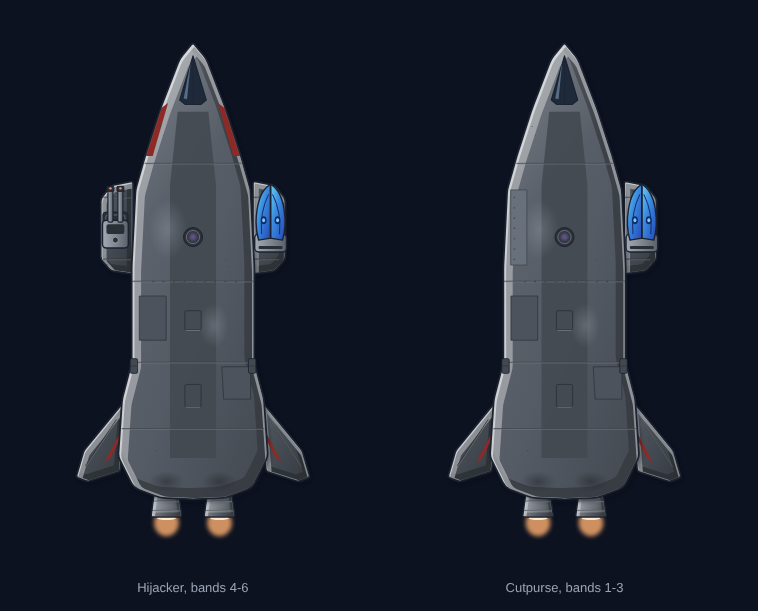
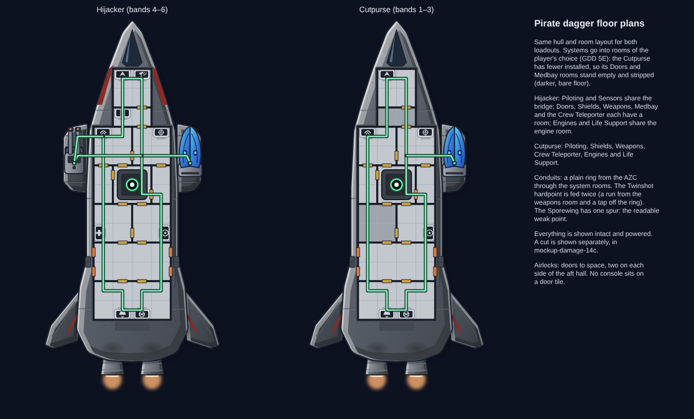

# Terran Pirate Hijacker hull (Hijacker and Cutpurse loadouts)

**Date:** 2026-10-23
**Status:** accepted by Ship Designs (version 3 of the review, the dagger cruiser). Ship design: `docs/ship-suggestions.md`,
"Terran Pirate Hijacker" and "Pirate Hijacker loadouts".

## What it is

A doomed-Terran pirate cruiser: clean and restrained, in dark gunmetal with a single oxblood accent. One hull, two
loadouts. The side weapon bays are modules that come with the loadout (**Ai-Generated-Proposal**, accepted by Ship
Designs):

| Loadout | Bands | Bay modules | Weapons | Look |
|---|---|---|---|---|
| Hijacker | 4–6 | both bays | Twinshot (port), Sporewing (starboard) | oxblood nose stripes |
| Cutpurse | 1–3 | starboard only; port bay faired over flush | Sporewing | plainer, no stripes, leaner and lopsided |

- **Hull only** in `pirate-*-hull.svg`: top-down, nose up, 480 × 760. Weapon mounts are hidden points in the
  `weapon-mounts` group. The weapons are separate art in `docs/art/weapons/` (`sporewing/`, `twinshot/`).
- **Previews** in `pirate-*-armed-preview.*` place the weapon files at the mounts, at 1.35× their file size, as
  the game would.
- **Wear,** kept sparing: soft scorching behind the engines and weapon ports, faded paint, a little pitting, and two
  replaced plates in a slightly different shade. Nothing drips.
- **Fittings:** a narrow swept canopy, a dorsal teleporter emitter, an airlock hatch on each flank (level with the
  floor plan's aft-hall airlocks, moved there at Ship Designs' request) and two engines.
- **No emblem.** There is no standard Gatos emblem (Decided), and heromedel's review asked for none or a small one.

## History

The first design (rejected by heromedel, 2026-10-23) was cluttered: rust streaks, a cat-skull emblem, a fanged nose
maw, and the stolen launcher clamped on as a moth with roots. Its loadouts looked the same. heromedel: "that ship
is hideous, cluttered, the rust seems to drip but things don't drip in space, gatos are not cats, the weapon looks
bolted in place and weird, it's almost dumb and cheesy compared to FTL and it looks like the same hull and weapons."
That design was not kept. Its lessons are in `docs/art/README.md`.

This design started fresh. Concepts considered:

- **Chined dagger cruiser with side bays:** picked; a classic, predatory cruiser shape, unlike the Outrider.
- **Twin-boom:** busy at squad zoom.
- **Hammerhead boarding prow:** read as alien.
- **Pincer ship:** cheesy.
- **Retrofitted box freighter:** no threat.

Versions: the dagger (picked), the dagger with canards, and a stepped hull (`versions.png`, `alternates/`).

| Pass | Changes |
|---|---|
| 1 | Hull widened 30% to hold a mid-tier ship's rooms; stronger oxblood accents on the nose chines and fins. |
| 2 | Weapons drawn, Sporewing style picked, previews composed from the separate weapon files. |
| 3 | Larger pods and weapons; the Cutpurse's empty bay became a neat flush plate. |
| 4 | A faint rim light so the dark hull holds its outline against space; squad and zoom check (`pirate-squad-view.png`). |

**Note for later (heromedel, 2026-10-23):** this hull is accepted as is, but there will be no more rocket-like
Terran designs for a while (race profiles, Terrans 1, Likely). See `docs/art/README.md`.

## Floor plans

**Accepted by Ship Designs (2026-10-23).** `floor-plans/floorplans.png` shows both loadouts side by side.

- **Layout:** one layout of 11 rooms on 35 px tiles, four columns wide:
  - bridge (Piloting, Sensors)
  - Doors room
  - Shields
  - Weapons, beside the starboard Sporewing pod
  - the 2×2 AZC core room, with empty 1×2 flank rooms
  - Medbay
  - Crew Teleporter
  - an aft hall with four airlock doors to space
  - an engine room (Engines, Life Support)
- **Rooms by loadout:** systems go into rooms of the player's choice (GDD 5E). The Cutpurse has no Sensors, Doors or
  Medbay, so its Doors and Medbay rooms stand empty and stripped (darker, bare floor).
- **Conduits:** a plain ring from the AZC through the system rooms. Every weapon hardpoint is wired:
  - **Twinshot (Hijacker):** fed twice, by a run from the weapons room across to the port hardpoint and a tap off the
    ring, so no single cut drops it. It is Terran-built and wired properly.
  - **Sporewing (both):** one spur from the weapons room out to the starboard hardpoint: the readable weak point,
    a crude refit of stolen tech.
  - The plans show everything intact and powered. A separate mockup, `mockup-damage-14c`, clearly labelled, shows the
    Sporewing spur cut with the GDD 14C red flash and the cut-off hardpoint turned red.
- **Weapon mounts:** whether conduits must reach each weapon mount on the hull, or only the Weapons room, is
  **Open** (race profiles, Terrans 6). heromedel asked to work as if mounts need power, so they are wired here.
- **Conduit check** (`floorplan.py` runs it before drawing):

  | Loadout | Systems on the network | Hardpoints wired | Single points of failure |
  |---|---|---|---|
  | Hijacker | 9 of 9 | 2 of 2 | the Sporewing spur (intended) |
  | Cutpurse | 6 of 6 | 1 of 1 | the Sporewing spur (intended) |

  The ring has two AZC exits, so two cuts beside the core would unpower the ship: accepted for a mid-tier pirate,
  tougher than a spine and weaker than the Outrider's wheel.
- **Fix (2026-10-23):** the first accepted plans left the Twinshot hardpoint unwired, and the Sporewing spur began on a
  tile the ring didn't reach. heromedel spotted the first; the new check caught the second.
- **Rules:** no console sits on a door tile. Consoles are wall desks with the system symbol in the hull's light
  steel; not red, since red means a cut-off system (GDD 14C).
- **Files:** each loadout has a floor layer (`floor-*.svg`), a conduit layer (`conduits-*.svg`, its own file as the
  art rules ask) and a combined plan (`plan-*.svg`).
- **Dark core hatch** (race profiles, Proposed): left off for now, at Ship Designs' call.

## Tools

| File | What it does |
|---|---|
| `tools/pirate.py` | Builds the hulls: `python3 pirate.py OUT_DIR hijacker cutpurse` (or `v1 v2 v3` for the versions) |
| `tools/weapons.py` | Builds the weapon files and the Sporewing options sheet |
| `tools/compose.py` | Places weapons at a hull's mounts: `python3 compose.py HULL.svg OUT.svg` |
| `tools/squad.py` | Builds the squad view against the Outrider |
| `tools/floorplan.py` | Builds the floor plans: `python3 floorplan.py HIJACKER_ARMED.svg CUTPURSE_ARMED.svg OUT_DIR` |
| `tools/art_kit.py`, `render.js`, `sheet.js` | Shared drawing kit, SVG-to-PNG, review sheets |
