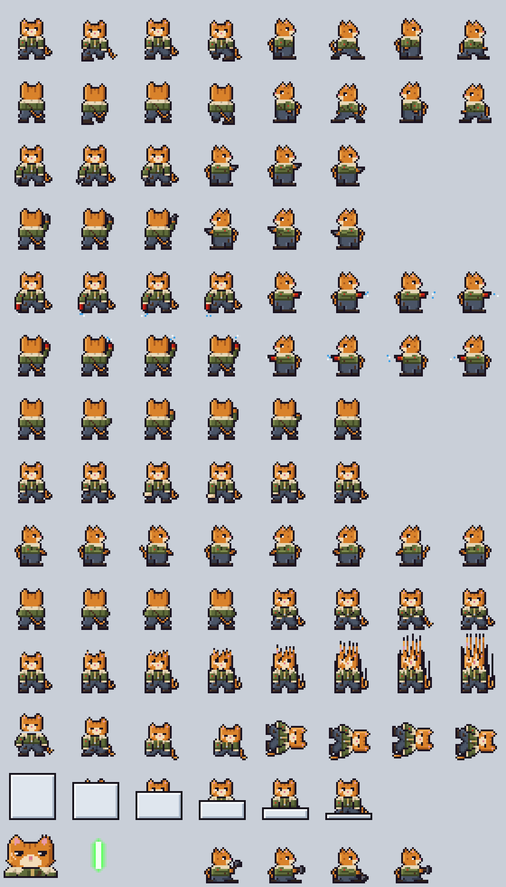
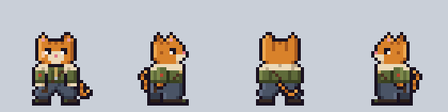

# Tabby crew sheet (Facing style)

**Date:** 2026-11-11
**Status:** a test, waiting for heromedel's verdict. The mercenary cat of
[`../cat-concept-for-gatos`](../cat-concept-for-gatos) animated, so the GATOS as Tabbys have a Facing sheet like the
Terran drifter's. The standing views are that concept's, unchanged; every animation frame is an
**Ai-Generated-Proposal (2026-11-11)**. Not in the game yet.

280 × 490 pixels: 35 × 35 frames, 8 per row, in the order of the other Facing sheets (the `eight-wide` layout in
`infall-godot/content/crew-layouts.xml`), with the boots on the same line.

| Row | Frames |
|---|---|
| 1 | Walk down, then walk right |
| 2 | Walk up, then walk left |
| 3 | Aim down, then aim right (three aims each: straight, a little one way, a little the other) |
| 4 | Aim up, then aim left |
| 5 | Fight fire down, then right (a red extinguisher in the same paw; only the spray moves) |
| 6 | Fight fire up, then left |
| 7 | Punch up |
| 8 | Punch down |
| 9 | Type right, then type left |
| 10 | Type up, then type down |
| 11 | Teleport |
| 12 | Death |
| 13 | Clone |
| 14 | Portrait, crew laser shot, a gap, then repair (4 frames) |

## How each animation is staged

- **Walk:** the first frame of each direction is him standing. On a step the body sinks a pixel onto the leading
  leg. Toward us, the leading boot lands a pixel below the standing line and shows more of its top, and the
  trailing boot is lifted, smaller and darker; the arms swing against the legs by a pixel. Away from us his arms
  stay ahead of him, out of sight, as when he stands. From the side the near and far legs stride in turn with the
  deck showing between them, and the near arm swings back to the holster and forward past his belly. The tail
  follows a beat behind: it sways beside his hip, flicks across his calf, or leans and straightens behind him.
- **Aim:** he draws the pistol, so the holster hangs empty. One arm acts, as on the other sheets. Toward us the arm
  is out from his side so the pistol hangs over the deck, clear of his leg.
- **Fight fire:** the aiming arm with a red extinguisher; four frames of spray.
- **Punch:** one arm. Toward us the fist draws back (the arm shortens), then comes at us long, the paw big and low.
  Away from us the elbow pokes out, then the arm goes out ahead of him, which from behind is up beside his head.
- **Type:** from the side the forearms are out and the paws tap in turn; toward us the paws meet at his belt; away
  from us his elbows work in turn. The tail tip flicks once a loop. The pistol is back in the holster.
- **Repair:** on one knee, a hammer up, forward, down on the work, forward.
- **Teleport, clone, laser shot:** made the same way as the Terran drifter's (`../crew-test-3`): his own columns
  dragged upward, the cool white plate lowering, the power-green shot.
- **Death:** he is hit (eyes shut, arms jolted out, a pixel off the deck), his knees turn in, he drops to both
  knees, tips to his left, and lies on his back with his head to our right, settling with one small bounce.
- **Portrait:** his head and shoulders drawn larger by hand: the heavy lids, the scar, the notched ear.

## How it is made

Every frame is drawn by hand as text, one character a pixel, in `tools/tabby.py`; the colours are in
`tools/pix.py`. A frame is a few hand-drawn parts laid back to front, and each pose of a limb is its own drawing.
Left-facing frames are the right-facing ones mirrored. Three things are worked out from drawn frames: the teleport,
the clone bay's plate and the laser shot (as on the drifter's sheet), and the lying figure of the death, which is
the hit pose turned a quarter turn (every pixel moves, none changes). `python3 tools/build.py`, run from this
folder, rebuilds the sheet and the pictures in `review/`.

## Review pictures

- `review/walk-4x.gif`, `walk-1x.gif`: walking down, right, up and left.
- `review/work-4x.gif`: typing down, right and up, repairing, and fighting fire down, right and up.
- `review/fight-4x.gif`: the three aims down, right and up, then punching down and up.
- `review/death-4x.gif`, `review/teleport-clone-4x.gif`.
