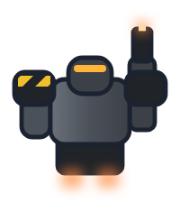

# Laser battlesuit

**Date:** 2026-10-23
**Replaced (2026-10-25):** the current laser battlesuit is the pixel version accepted with the battle-cross frame:
`docs/art/mecha/light-attack-frame/pixel-redo/weapons/battlesuit-laser.*`. This vector version follows the old Mecha
colours and is kept for the record.
**Status:** accepted by Ship Designs, with the Mecha Light Attack Frame. The EVB Dock's suit type (race profiles, Mecha
6; `docs/ship-suggestions.md`, "Mecha Light Attack Frame, two loadouts", point 9).

A HalfMech's mech inside an outer battle suit: squat and armoured, with broad shoulders (one with a hazard stripe), a
hunched helm with an amber visor slit, a laser on its right arm (1 damage) and a jump pack with two thrusters. Drawn
top-down facing up, centred at (0, 0). Launched from the Light Attack Frame's Suit Dock loadout.

Three styles were tried (`docs/art/weapons/ds-st-hull-laser/mecha-weapon-options.png`, bottom row): brute (picked), a
rounded beetle shell, and an angular frame.

The builder is `docs/art/mecha/light-attack-frame/tools/mecha_weapons.py`.
