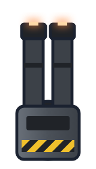

# DS-ST Hull Laser (Double Shot - Single Target - Hull Laser)

**Date:** 2026-10-23
**Superseded look (2026-10-25):** this art follows the old Mecha colours (gunmetal with hazard markings), which
`docs/art/style-guides.md` replaces; to be redone in the Mecha style.
**Status:** accepted by Ship Designs, with the Mecha Light Attack Frame. Weapon design: `docs/ship-suggestions.md`,
"Mecha Light Attack Frame, two loadouts", point 9.

A squat Mecha turret block on a hardpoint ring with two parallel heavy barrels, one per shot of the double shot, and
hot emitters at the muzzles. Gunmetal with a hazard stripe. Drawn top-down pointing up, centred on its mount at
(0, 0). Used on the Light Attack Frame's Hull Laser loadout, on the starboard shoulder pod.

Three styles were tried (`mecha-weapon-options.png`, top row): twin (picked), a breaker with one broad barrel and heat
fins, and a stacked barrel with two capacitor drums.

The builder is `docs/art/mecha/light-attack-frame/tools/mecha_weapons.py`.
